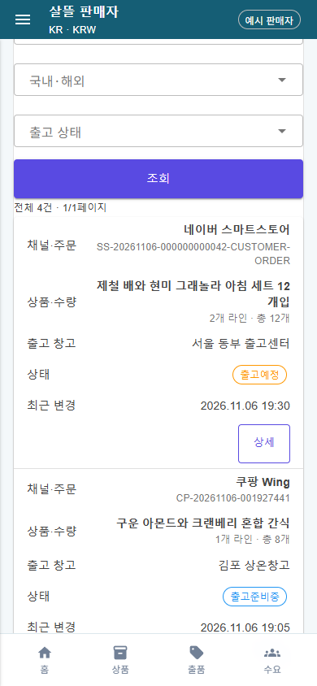

# 판매 주문 목록의 모바일 항목명 줄바꿈

가상 판매 주문 네 건을 불러오면 **채널·주문**과 **상품·수량**이 390px에서 두 곳, 320px에서 네 곳에서 글자 중간에 갈렸다. [이전 390px 목록](../assets/changes/2026-11-07-seller-account-contrast/orders-390.png)

[공용 판매 주문 목록 스타일](../../Ssalddel.Ui.Common/Areas/App/Components/Sales/ShipperSalesOrderWorkspace.razor.css)에서 두 항목명만 한 줄로 묶었다. 긴 주문번호와 상품명은 값 영역에서 줄바꿈된다. 수정 전후 같은 가상 자료에서 320px와 390px 모두 항목명 끊김이 0곳이고, 표 너비는 각각 286px와 356px였다. 모든 **상세** 링크가 표 안에 들어왔고 1280px에서는 기존 열 머리말과 표 너비를 확인했다.

2026-11-07 · 390px 로컬 Chrome · 가상 판매 주문 네 건. **상세**를 열면 같은 주문의 출고 요약과 후보 라인이 나온다. **주문 목록**으로 돌아오면 적용한 검색 조건을 유지한다.

같은 주문 42번의 두 출고 후보와 각 6개 수량을 확인했다. 320px 터치, 390px 키보드 Enter, 1280px 클릭으로 상세를 열고 목록 복귀와 검색 조건 유지까지 확인했다. 390px의 정상 빈 결과에서 **필터 지우기**로 네 건을 다시 표시했다. 수정 전후 각 7개 묶음이 통과했고 브라우저 오류와 외부·업무 API 요청은 0건이었다.

Fast 관련 시험 40개와 판매자 앱·통합 웹을 포함한 통합 3.5 Task 시험 17,053개가 통과했다. 별도 환경이 필요한 시험 17개는 건너뛰었다. Fast 빌드 경고 0개와 통합 빌드 경고 62개를 확인했고 두 빌드 모두 오류는 0개였다.

이번 브라우저는 실제 판매자 Razor와 공용 스타일에 가상 조회 응답을 연결했다. 제품 서버·실기기는 미검증이다. [기존 상세 화면](../assets/changes/2026-11-07-seller-account-contrast/detail-390.png) · [이전 긴 주문번호 검증](2026-11-06-seller-order-row-readability.md)

전후 캡처, 입력 지문과 시험 결과는 `artifacts/local/mirror-ui-assist/20261106T224602691Z-seller-mobile-label-wrap/validation.json`에 연결했다.
