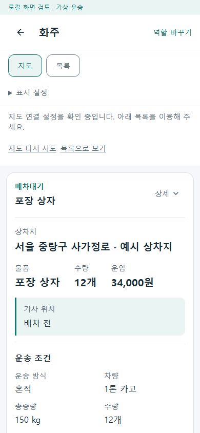

# 통합 화주 지도 미설정과 목록 전환

가상 의뢰를 불러온 통합 화주에서 지도 연결이 미설정이면 빈 지도 영역의 높이가 약 338px였다. 320px·390px에서 **목록으로 보기**는 화면 상단에서 603px, 현재 운송 카드는 674px 아래에 표시됐다. [이전 화주 지도 캡처](../assets/changes/2026-10-06-role-tools-r22/shipper-tools-390.png)

[화주 지도 상태](../../Ssalddel.Ui.Common/Areas/App/RoleWorkspace/Core/RoleMapWorkspace.razor)와 [공용 화면 스타일](../../Ssalddel.Ui.Common/Areas/App/RoleWorkspace/Core/RoleMapWorkspace.razor.css)을 연결해 540px 이하의 화주 지도 미설정 상태에서 빈 영역을 접었다. 320px·390px의 버튼과 카드 위치는 각각 265px와 336px로 앞당겨졌다. 48px 버튼과 상태 안내 아래로 현재 의뢰의 상태·수량·운임을 이어 읽을 수 있다.

2026-11-07 · 390px 로컬 Chrome · 가상 화물 의뢰 3건. **목록으로 보기**를 누르면 현재 의뢰가 선택된 운송 목록이 열립니다.

320px 터치와 390px 키보드로 목록을 열어 같은 의뢰를 확인했다. 목록에서 가구 의뢰를 골라 **상세**를 펼치고 하차지·운임을 대조했다. **접기**로 같은 목록을 보고 지도로 돌아와도 선택이 유지됐다. 541px·1280px 화주와 390px 화물기사에서 기존 지도 높이를 대조했다. 격리 응답으로 지도 준비·응답 지연과 재시도 중 높이 복원도 확인했다. 변경 전 브라우저 검사 61개와 수정 후 76개가 통과했다.

Fast 관련 시험 24개와 통합 3.5 Task 시험 17,054개가 통과했다. 환경 조건이 필요한 시험 17개는 건너뛰었다. Fast 빌드 경고는 0개, 통합 앱과 웹을 포함한 Task 빌드 경고는 140개였고 오류는 각각 0개였다.

브라우저에서 공용 화면과 웹 지도 호스트를 연결하고, 키가 없는 지도 설정 응답과 가상 운송을 사용했다. 실제 지도 SDK·실기기·제품 서버는 미검증이다. 같은 데이터의 전후 화면과 측정값은 `artifacts/local/mirror-ui-assist/20261107T031606862Z-shipper-map-unconfigured-list/validation.json`에 연결했다.
