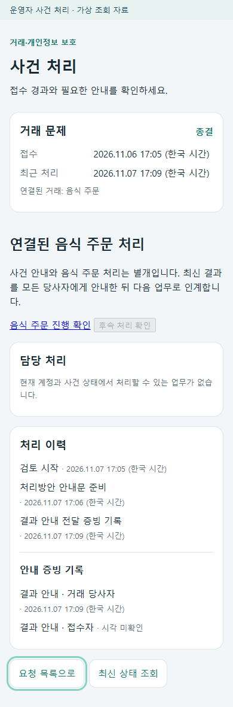

# 운영자 사건의 처리 시각 줄바꿈

운영자 **사건 처리**에서 **처리방안 안내문 준비**, **결과 안내 전달 증빙 기록**과 거래 당사자 안내를 읽을 때 390px에서 **한국 시간**이 세 곳에서 갈렸다. 현재 공용 화면에 가상 사건을 로드해 재현했다. [이전 390px 화면](../assets/changes/2026-10-06-apk-workflow-completion-r26/support-admin-390.png)

[공용 사건 처리 화면](../../Ssalddel.Ui.Common/Areas/BackOffice/Components/PrivacySupport/보호지원관리Page.razor)의 **처리 이력**과 **안내 증빙 기록**에서 날짜·시각·한국 시간 표기를 함께 다음 줄로 보낸다. 가상 사건의 같은 시각과 순서를 비교한 결과 320px·390px·1024px에서 시각 표기 중간 끊김과 가로 넘침이 없었다. 시각이 없는 안내는 **시각 미확인**으로 보인다.

2026-11-07 · 390px 로컬 Chrome · 가상 거래 문제의 처리 이력과 안내 증빙. **요청 목록으로**를 누르면 사건 목록이 열린다.

수정 전후 모두 키보드로 가상 사건 세 건의 목록에 돌아가 같은 종결 사건을 다시 열었다. 정상 빈 이력, 조회 오류의 목록 복귀, 운영자 로그인 화면도 구분했다. 브라우저 오류와 외부·업무 API 시도는 0건이다. 이 화면은 실제 공용 Razor와 로컬 합성 조회 응답을 사용했다. 운영 자료, 실제 통지와 기기는 미검증이다.

Fast 관련 시험 36개와 운영자 앱·웹을 포함한 통합 3.5 Task 시험 17,053개가 통과했다. 별도 환경이 필요한 시험 17개는 건너뛰었다. Fast 빌드 경고는 2개, 통합 빌드 경고는 392개였고 두 빌드 모두 오류는 0개였다.

전후 캡처, 소스 지문과 검증 근거는 `artifacts/local/mirror-ui-assist/20261106T221602189Z-support-history-time-wrap/validation.json`에 연결했다.
