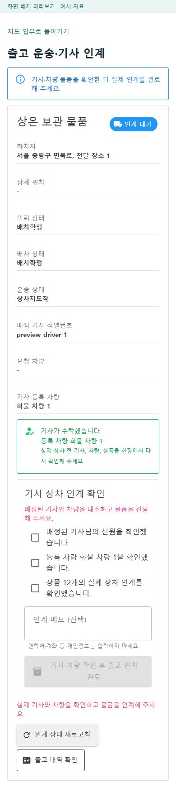

# 창고 출고 인계의 조회 버튼 줄바꿈

가상 출고예정 701번의 390px 인계 화면에서 **인계 상태 새로고침**과 **출고 내역 확인**의 마지막 단어가 중간에서 끊겼다. [공용 출고 인계 화면](../../Ssalddel.Ui.Common/Areas/App/Components/WarehouseOperations/SsalddelTransportRequestDraftWorkspace.razor)은 두 버튼을 담는 기존 행에 줄바꿈을 허용한다. 두 버튼이 한 줄에 들어갈 공간이 부족하면 뒤쪽 버튼 전체가 다음 줄로 내려간다. [이전 가상 인계 캡처](../assets/changes/2026-10-05-state-card-polish-r18/warehouse-handoff.jpg)

320px와 390px에서 각 문구가 한 줄로 표시되고 마우스·터치 모드 모두 버튼 높이는 48px였다. 1280px에서는 두 버튼이 한 행에 표시됐다. **인계 상태 새로고침**으로 같은 가상 건을 읽고 **출고 내역 확인**으로 출고예정 701번의 검토 화면을 연 뒤 인계 상세로 돌아왔다.

2026-11-07 · 390px Chrome · 공용 역할 미리보기의 가상 출고. 기사 수락과 등록 차량, 상품 12개 인계 확인, 두 조회 버튼이 표시된다.

수정 전 브라우저 검사 45개, 수정 후 55개를 통과했다. Tab 순서와 복귀, 세 확인 항목이 미선택일 때 출고 인계 완료가 비활성인 상태를 대조했다. 브라우저 검증은 공용 역할 경로의 가상 출고 한 건을 사용했다. 창고 앱과 웹의 전문 작성 화면은 빌드로 확인했다.

공용 UI Fast 관련 시험 47개와 창고 앱·웹을 포함한 통합 3.5 Task 시험 17,051개가 통과했다. 별도 환경이 필요한 17개는 생략했다. Fast 빌드 경고는 2개, 통합 빌드 경고는 63개였고 두 빌드 모두 오류는 0개였다.

제품 서버·DB, 실제 인계 실행과 기기는 미검증이다. 전후 화면과 시험 근거는 artifacts/local/mirror-ui-assist/20261106T194629804Z-warehouse-handoff-actions/validation.json에 연결했다.
