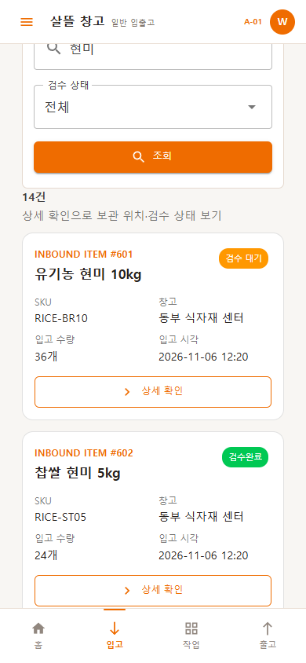

# 창고 입고 검수 목록의 상세 안내

가상 입고가 로드된 목록에서 검색 결과 위 안내에 개발 용어가 보였다. [이전 390px 목록](../assets/changes/2026-11-06-warehouse-inspection-list-return/list-390.png)

[공용 목록](../../Ssalddel.Ui.Common/Areas/App/Components/WarehouseOperations/InboundInspectionListScreen.razor)의 안내를 **상세 확인으로 보관 위치·검수 상태 보기**로 바꿨다. 창고 앱과 통합 웹의 페이지 설명도 검수 대상 검색과 상태 확인을 안내한다. 320px·390px에서 새 안내 한 줄과 **상세 확인**을 확인하고 1440px에서도 잘림이 없는지 대조했다.

2026-11-07 · 390px 로컬 Chrome · 가상 검수 대기·완료 입고. **상세 확인**으로 해당 상품의 보관 위치와 검수 상태를 보고 **검수 목록** 또는 **목록**을 누르면 마지막으로 조회한 조건과 페이지로 돌아갑니다.

가상 입고 #601의 상품명·36개·보관 위치·검수 대기를 상세에서 대조했다. 320px 터치, 390px 키보드, 1440px 클릭으로 상세를 열었다. 목록에 돌아오면 ‘현미’·상태 전체·2페이지가 복원됐다. 검색 결과 0건과 검색어를 비운 뒤 첫 페이지 조회도 확인했다. 브라우저 확인은 변경 전 69개, 최종 72개가 통과했다. [이전 목록 복귀 기록](2026-11-06-warehouse-inspection-list-return.md)

Fast 관련 시험 53개와 통합 3.5 Task 시험 17,054개가 통과했다. 별도 환경이 필요한 시험 17개를 건너뛰었다. 빌드 경고는 Fast 2개, Task 63개였고 오류는 각각 0개였다.

로컬 브라우저에서 창고 역할의 공용 목록·상세와 격리된 가상 조회를 사용했다. 통합 웹은 빌드로 확인했다. 실제 앱·제품 서버·검수 저장은 미검증이다. 전후 캡처와 검증 자료는 `artifacts/local/mirror-ui-assist/20261107T004604559Z-warehouse-inspection-list-guide/validation.json`에 연결했다.

## 2026-11-10 후속 — 실제 통합 웹에서 조회·복귀 확인

이전 창고 앱 미리보기와 같은 가상 목록을 현재 통합 웹에서 읽었다. 320px 터치, 390px 키보드, 1440px 마우스로 입고 601번의 상품·36개·보관 위치·검수 대기를 확인했다. 마지막 조회는 ‘현미’·상태 전체·2페이지였고, 조회하지 않은 새 검색어는 상세 주소나 복귀 주소에 섞이지 않았다. 호환 주소에서 열어도 기본 상세·목록 주소로 연결됐다. 새 검색어를 명시 적용한 0건과 검색어를 비운 첫 페이지도 확인했다.

실제 Chrome 확인 63개·화면 원본 12장·격리 읽기 24건(검수 목록·상세 15건)이다. [판본과 조회 근거](../../artifacts/local/warehouse-inbound-inspection-live-20261110/completion.json) · [390px 목록 복귀 화면](../../artifacts/local/warehouse-inbound-inspection-live-20261110/return-390.png). 기본 주소를 잘못 가정한 첫 검증 기록은 보존했다. 기존 빌드의 소스 지문을 대조했으며 제품 코드·검수 저장·운영 서버·실제 기기는 건드리지 않았다.
