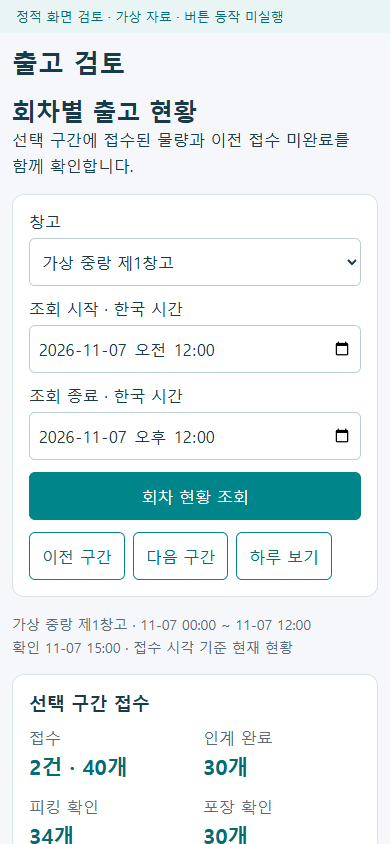

# 창고 회차별 출고 현황

2026-11-07. 사용자가 승인한 업무 주기 보강 제안의 첫 대상으로 일반 창고의 출고 진행 조회를 구현했다. 기존 출고 검토 화면에서 **회차별 현황**을 열고 창고·한국 시간 구간을 선택한다.

선택 구간 접수, 이전 접수 미완료, 건별 최초 접수·담당·다음 확인, 현재 배정 부하와 선택일·직전 7일을 함께 읽는다. **같은 출고 검토**로 상세를 확인한 뒤 **회차별 현황**으로 돌아오면 같은 창고·기간·조회 결과가 유지된다. 화면 책임과 조회 계약은 [상세 설명](../ProjectOverview/page-docs/warehouse-outbound-periods.md)을 따른다.

## 화면

가상 창고 2곳과 오전·오후 두 구간, 전일 미완료, 부분 피킹·인계 완료·작업 연결 미확인을 사용했다. 아래는 공용 화면·ViewModel·조회 Service에 가상 응답을 연결한 실제 컴포넌트의 정적 렌더다. 시작을 포함하고 종료를 제외하는 최대 24시간을 조회한다.

접수 귀속은 출고예정의 최초 생성 시각이다. 이전 접수 미완료와 날짜별 비교는 조회 시점의 현재 상태다. 피킹·포장은 연결된 완료 작업의 확인 수량을 공정별로 표시한다. 인력은 창고 등록·배정 인원·미완료 작업을 표시하고 현장 근무는 미확인으로 안내한다.

## 구현과 검증 경계

- 기존 `GET api/v1/warehouse-operations/outbound-plan-reviews`에 선택적 UTC 기간을 추가했다. 동일 창고 권한을 확인하고 서버 전체 원장에서 집계한 `Period`를 부가한다. 기간을 보내지 않으면 새 `Period` 필드를 직렬화하지 않는다.
- 집계는 검색·페이지와 독립적이다. 부분 완료·취소·누락 작업·잘못된 시각과 수량을 구별하고, 관계형 조회는 동일 트랜잭션에서 읽는다. MySQL의 재시도 실행 전략을 사용한다.
- 창고·입력 구간 변경과 계정·세션·서버 변경은 이전 응답을 무효화한다. 같은 조건의 재조회 실패는 이전 결과와 서버 확인 시각을 남긴다. 기존 상세에서 복귀할 때 이전 계정의 목록·상세가 표시되지 않도록 재검증한다.
- 실제 SQLite와 공용 컴포넌트의 이벤트 처리를 포함한 집중 시험 73개가 통과했다. 가상 자료 9상태의 파일 렌더를 320px·390px·1280px로 열어 배치 검사 231개가 통과했고 쓰기 시도와 외부 요청은 0건이었다.
- 구현·시험 14개 경로를 지정한 최종 `Fast`는 관련 시험 73개, `Task`는 전체 17,120개 통과·환경 의존 17개 생략·실패 0개다. 창고 앱·웹과 공용 UI 소비 앱을 포함한 `Ssalddel.v3.5.slnx` 빌드는 두 단계 모두 오류 0개이며 경고는 각각 140개·62개다. 최종 로그는 `artifacts/local/validation/20261107-132443`과 `20261107-132618`에 남겼다.

자동 승인 검토가 로컬 미리보기 서버의 시작을 거절했다. 따라서 브라우저 안에서 실제 버튼을 조작하는 검증은 미실행이다. 화면 이벤트는 컴포넌트 자동시험으로 확인했고 이미지는 서버를 시작하지 않는 `HtmlRenderer` 출력의 Chrome 렌더로 검사했다. 실제 MySQL·실기기·운영 사용은 미검증이다.

시안·초기 실패·수정 후 결과와 실제 제품 입력은 `artifacts/local/warehouse-periods-20261107/validation.json`에서 연결한다. 이전 화면은 [출고 검토 기록](2026-07-20-warehouse-outbound-plan-review.md)에서 확인할 수 있다.
