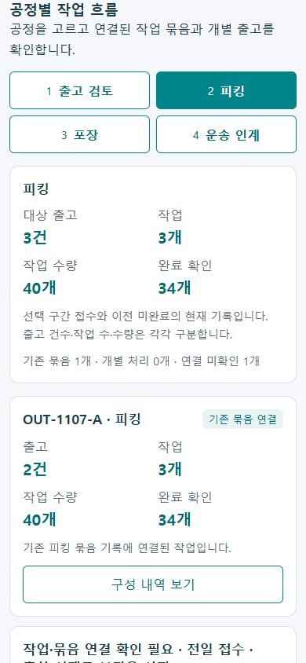
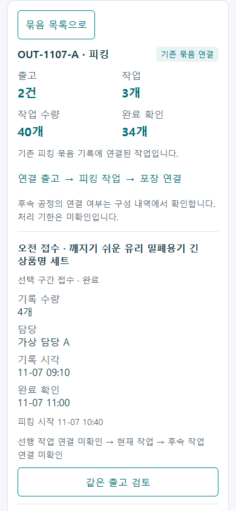

# 창고 공정과 작업 묶음 연결

2026-11-07. 업무의 생명주기 단계 안에서 단건과 여러 건의 처리 묶음을 이어 볼 수 있도록 기존 창고 **회차별 현황**을 확장했다. 이번 적용은 창고 출고의 읽기 화면·조회 계약이다. 전체 역할의 자동 배치 실행이나 새 작업 배정 기능은 포함하지 않는다.

**출고 검토 → 피킹 → 포장 → 운송 인계**에서 공정을 고르고 **구성 내역 보기**로 실제 작업 묶음을 연다. 상품·기록 수량·담당·시각과 선행/후속 연결을 읽은 뒤 **같은 출고 검토**로 원래 업무를 확인한다. **회차별 현황** 복귀는 창고·구간·공정·묶음과 구성 페이지를 보존하고, **묶음 목록으로**는 선택 전 묶음 페이지로 돌아간다. 페이지 책임과 상세 조회 계약은 [화면 설명](../ProjectOverview/page-docs/warehouse-outbound-periods.md)을 따른다.

## 가상 업무를 불러온 화면

2026-11-07 한국 시간, Windows의 Chrome 파일 렌더다. 실제 공용 회차·공정 컴포넌트와 ViewModel·조회 Service에 격리한 합성 응답을 연결했다. 서로 다른 길이의 상품명·상태·수량, 여러 묶음, 전일 미완료와 연결 미확인을 사용했다. 운영 자료와 실기기를 사용하지 않았다.

묶음 제목에는 기존 출고묶음 번호와 공정을 표시한다. 개별 작업·개별 출고와 번호가 없는 포장 묶음은 현재 범위의 상품명을 함께 보여 여러 카드를 구별한다. 임의의 묶음 번호는 만들지 않는다.

두 번째 이미지는 같은 묶음의 **선택 묶음의 구성 내역** 영역으로 스크롤한 390×844 화면이다. 첫 상품의 주 행동까지 보인다. 이미지를 열면 전체 구성 내역을 볼 수 있다.

## 기간·단계·묶음의 구분

- 기간은 조회 구간이며 실제 묶음의 생성 기준이 아니다. 기존 선택 구간 접수와 이전 접수 미완료를 같은 권한·창고 범위에서 읽는다.
- 기존 출고묶음 원장 연결이나 일치하는 포장 완료 근거가 있는 경우만 **기존 묶음 연결**이다. 원장 한 건은 **개별 출고**, 명시 묶음 없는 작업 한 건은 **개별 작업**, 모순·누락은 **연결 미확인**으로 구분한다. 단건과 여러 건의 실제 구성은 별도로 보인다.
- 시간·작업자·주문 문자열만으로 작업을 묶지 않는다. 원출고 건수·작업 수·수량도 별도로 표시한다. 미확인 묶음의 합계와 완료 수량은 **미확인**이며 구성원의 기록 수량과 구별한다.
- 묶음에 조회 범위 밖 구성원이 있으면 현재 범위의 수량이라는 안내를 보인다. 범위 밖 번호·수량과 작업자 식별값·바코드·완료 근거 원문은 응답에 싣지 않는다.
- 정상 취소 출고와 잘못된 작업 연결을 구별한다. 검토 완료량과 처리 기한은 근거가 없으면 미확인이다. 운송 인계 완료는 창고 인계 기록이며 최종 배송 완료를 뜻하지 않는다.

묶음·구성 내역·기존 개별 출고의 페이지를 독립적으로 조회한다. 창고·구간·공정·묶음이 바뀌면 이전 결과와 늦게 도착한 응답을 무효화한다. 같은 조건의 재조회 실패에만 이전 결과와 서버 확인 시각을 남긴다. 선택 묶음이 없어졌을 때도 **묶음 목록으로** 돌아갈 수 있다.

## 검증과 남은 범위

실제 SQLite 조회와 공용 컴포넌트 이벤트 시험으로 명시 묶음·분할 작업·포장 근거·취소·범위 밖 구성·권한·독립 페이지와 오래된 응답 차단을 검증했다. 구현·시험 13개 경로를 지정한 최종 `Fast`는 관련 시험 116개, `Task`는 전체 17,178개 통과·환경 의존 17개 생략·실패 0개다. 창고·웹과 공용 UI 소비 앱을 포함한 `Ssalddel.v3.5.slnx` 빌드는 두 단계 모두 오류 0개이며 경고는 각각 283개·51개다. 로그는 `artifacts/local/validation/20261107-145539`와 `20261107-145716`에 보존했다.

정적 렌더는 16상태의 실제 ViewModel 검사 117개와 320px·390px·1280px 배치 검사 1,293개가 통과했다. 가로 넘침·브라우저 오류·외부 요청은 없었으며 합성 조회의 쓰기 시도는 0건이다. 동일 공용 DLL·CSS와 소스/PDB 결속을 확인했다. 새 공정 패널과 회차 부모는 실제 렌더했고 최상위 개별 출고 상세 부모는 이번 정적 출력에 포함하지 않았다.

브라우저에서 실제 버튼을 누르는 상호작용·키보드 초점 이동, MySQL·실기기·운영 서버는 미검증이다. 컴포넌트 이벤트 시험과 직접 ViewModel 조작을 실제 브라우저 조작으로 표현하지 않는다. 추가 초점 시험은 보조 렌더러의 요소 참조 한계로 판정 불가였으며 실패 기록을 보존했다. 새 자동 일정·배정·업무 상태 변경·배포·커밋·푸시는 수행하지 않았다.

시안·원본 변경 보존·자동시험·이미지 해시와 미실행 항목은 `artifacts/local/warehouse-batch-flow-20261107/validation.json`에 연결한다. [이전 회차 화면과 원본 근거](2026-11-07-warehouse-outbound-periods.md)는 보존한다.
