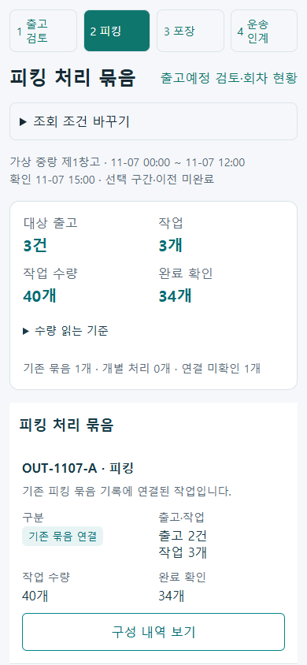
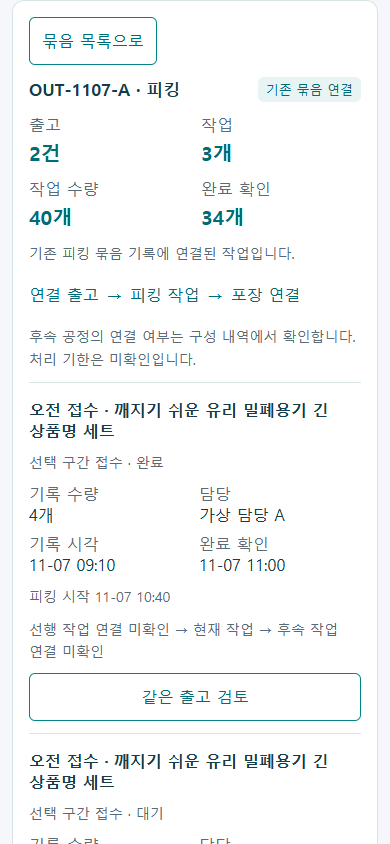

# 웹 창고 업무 단계에서 처리 묶음과 상세로 이동

2026-11-07. 출고 검토 한 페이지 안에서 공정을 바꾸던 조회를 웹의 단계별 진입으로 연결했다. 창고 메뉴의 **1 출고 검토 묶음 → 2 피킹 묶음 → 3 포장 묶음 → 4 운송 인계 묶음**은 기존 출고 공정의 표시 순서를 사용한다. 번호는 출고 공정 내부의 순서이며 역할 번호·문서 화면 ID와 구분한다.

선택한 단계의 본문은 처리 묶음 테이블이다. **구성 내역 보기**로 선택 묶음의 구성 업무·수량·담당·시각과 선행/후속 연결을 확인하고, **같은 출고 검토**로 현재 표시된 구성원 한 건을 연다. 기존 단건 작업·운송 전 검토·회차 현황과 운송의뢰 기능은 그대로 진입할 수 있다. [화면 책임과 조회 계약](../ProjectOverview/page-docs/warehouse-outbound-periods.md)

## 정상 가상 업무 화면

아래는 2026-11-07 Windows의 Chrome 파일 화면이다. 실제 공용 컴포넌트·ViewModel·조회 Service에 격리 합성 응답을 연결한 정적 렌더이며 운영 자료와 실제 기기를 사용하지 않았다.

넓은 화면은 묶음·구분·출고/작업 수·수량·완료 확인·구성의 테이블이고, 휴대폰은 같은 항목을 세로로 배치한다. 정상 조회 뒤에는 현재 창고·구간·확인 시각을 남기고 **조회 조건 바꾸기**로 입력을 다시 연다. 최초 조회와 결과가 없는 오류에서는 조건 입력을 펼친다. 일반적인 수량 설명은 **수량 읽는 기준**에서 볼 수 있으며 미확인·범위 밖 구성·취소와 인계 완료의 의미는 관련 위치에 표시한다.

묶음 상세는 선택한 구성과 흐름을 보여 준다. 전체 묶음 목록이나 날짜별 보고를 아래에 이어 나열하지 않는다. 개별 검토에서는 **묶음 구성 내역으로**, 구성에서는 **묶음 목록으로** 돌아간다. 범위 밖 구성의 상세와 현재 구성 페이지에 없는 원출고를 주소로 선택해도 임의의 다른 업무를 표시하지 않는다.

[같은 가상 출고의 검토 화면](../assets/changes/2026-11-07-warehouse-stage-entry/review-390.png)은 원출고 1102의 수량 10개다. 해당 출고의 피킹 작업은 완료 4개와 대기 6개로 나뉜다. 다른 출고의 완료 30개를 합친 묶음은 40개·완료 확인 34개이며 원출고·작업 수·작업 수량의 단위를 구분한다. 목록 대표 이미지는 같은 HTML에서 검증 배너 높이 33px만 스크롤해 단계 메뉴와 첫 묶음 버튼을 함께 담았다. 원본·스크롤·해시는 별도 근거에 보존한다.

## 탐색·조회 경계

- 기존 `/warehouse/general/outbound-plan-review`의 `stage` 조회 문맥으로 공정별 진입을 제공한다. API·원장·업무 상태·배정·자동 실행은 추가하지 않았다. 단계가 없는 기존 주소와 별칭도 유지한다.
- URL은 창고·UTC 구간·공정·묶음/구성/원출고 페이지와 선택 ID를 담는다. 기간은 최대 24시간이며 한국 시간으로 입력·표시한다. 잘못된 단계·날짜·페이지는 조회 오류로 구분한다. 시간·작업자·주문 문자열로 실제 묶음을 만들지 않는다.
- 목록·구성·개별 검토는 같은 조회 문맥을 보존한다. 통합 웹과 `/roles/05/` 역할 웹의 기준 경로 안에서 이동하며, 브라우저 뒤로 가기와 같은 주소 매개변수 재적용으로 이전 선택을 복원한다.
- 단계 메뉴의 선택은 조회 조건 순서와 관계없이 현재 단계 하나만 표시한다. 기존 일반 검토 메뉴, 잘못되거나 중복된 단계, 모바일의 통합 **출고** 메뉴를 구별한다.
- 새 개별 상세는 현재 선택 묶음의 표시 구성원만 읽고 응답의 출고 ID까지 대조한다. 계정·세션·서버·단계가 바뀌면 이전 결과와 늦은 상세를 표시하지 않는다. 상세 실패는 같은 선택 주소에서 재조회하거나 구성으로 복귀할 수 있다.

코드는 [웹 진입](../../Ssalddel.WebApp/Pages/WarehouseOutboundPlanReviewPage.razor), [공용 단계 화면](../../Ssalddel.Ui.Common/Areas/App/Components/WarehouseOperations/SsalddelOutboundBatchWorkspace.razor), [탐색 문맥](../../Ssalddel.Ui.Common/Areas/App/ViewModels/OutboundBatchNavigationState.cs), [공정·묶음 표시](../../Ssalddel.Ui.Common/Areas/App/Components/WarehouseOperations/SsalddelOutboundWorkflowPanel.razor)에 연결한다.

## 검증 범위

최종 `Fast`의 관련 시험 233개가 통과했다. 실제 컴포넌트 이벤트, 주소 해석·매개변수 재적용, 같은 구성원의 상세와 복귀, 잘못된 상세·권한·오래된 응답 차단을 검사했다. 취소를 무시한 이전 조회가 새 상세 주소를 목록으로 되돌리는 경합은 실제 이벤트 5개로 수정 전 실패를 재현하고, 현재 조회 판본일 때만 이동 콜백을 발행하도록 수정했다. 같은 회귀가 수정 후 통과했다. 최초 메뉴 helper의 불필요한 의존성 오류와 역할 메뉴 개수를 잘못 가정한 시험도 원인을 확인해 수정하고 기록을 보존했다.

구현·시험 18경로를 지정한 최종 `Fast`는 233개 통과·실패 0개, `Task`는 전체 17,301개 통과·환경 의존 17개 생략·실패 0개다. Fast의 관련 프로젝트 빌드 경고는 2개, Task의 `Ssalddel.v3.5.slnx` 통합 소비 빌드 경고는 51개이며 오류는 모두 0개다. 최종 로그는 `artifacts/local/validation/20261107-154642`와 `20261107-155611`이다. 앞선 전체 실행에서 기존 위치 복구 시험 한 건이 2초 제한을 넘겼지만 같은 위치 시험 묶음 25개가 코드를 바꾸지 않은 분리 실행에서 통과했고, 같은 소스의 최종 전체 Task도 통과했다. 최초 시간 초과와 분리 재확인 기록도 보존했다.

실제 공용 컴포넌트·모델·서비스의 21상태와 해석 검사 110개, 320px·390px·1280px의 파일 브라우저 배치 검사 2,703개가 통과했다. native details 클릭·Enter 66사례와 펼친 320px 입력, 캡션 폭·높이, 가로 넘침을 대조했다. 쓰기 시도·외부 요청·브라우저 오류는 0건이다. 공용 DLL·CSS·소스/PDB 7개와 캡처의 결속을 확인했다.

390px에서 첫 묶음 시작은 1,120.34px에서 600.17px, 첫 묶음 버튼 하단은 1,378.73px에서 858.56px로 520.17px 올라왔다. 기본 844px 검토 창에서 버튼 전체까지 약 15px 스크롤이 남는다. 320px의 버튼 하단은 1,518.30px에서 975.73px로 줄었다. 이 수치는 공용 컴포넌트의 정적 검토 창 기준이다.

실제 브라우저의 C# 업무 버튼·조회 제출·라우터 뒤로 가기·초점 이동, 전체 역할 셸 시각·실기기·운영 서버·MySQL은 미검증이다. 네이티브 HTML 조건 펼치기 검사는 C# 업무 상호작용과 구분한다. 별도 사용자 요청으로 기존 30분 예약의 개선 기준을 업무 주기·처리 묶음 중심으로 갱신했으며 새 예약·업무 스케줄러는 만들지 않았다. 배포·커밋·푸시는 수행하지 않았다.

시안, 기존 변경 보존, 초기/최종 렌더, 로그·해시와 미실행 범위는 `artifacts/local/warehouse-stage-entry-20261107/validation.json`에서 연결한다. [이전 공정·묶음 화면](2026-11-07-warehouse-stage-batches.md)과 [최초 회차 화면](2026-11-07-warehouse-outbound-periods.md)은 보존한다.

## 2026-11-10 후속 — 통합 웹의 실제 단계 이동

같은 가상 창고 101과 11월 7일 한국 시각 00:00~12:00을 사용했다. 현재 통합 웹의 WASM·CSS를 Chrome에서 로드하고 320·390px에서는 터치, 1280px에서는 키보드로 본문의 단계 메뉴를 순회했다. 단계별 읽기 요청·묶음, 선택 표시·제목 초점, 창고·기간 유지, 이전 묶음 선택 해제와 브라우저 뒤로 가기의 피킹 501 복원을 확인했다. 기존 정적 원본과 시험 결과는 보존했다. 이번에는 제품 소스를 수정하지 않았다.

실제 브라우저 확인 150개·화면 원본 12장·격리 읽기 57건이다. [판본과 브라우저 근거](../../artifacts/local/warehouse-stage-navigation-live-20261110/completion.json) · [390px 포장 화면](../../artifacts/local/warehouse-stage-navigation-live-20261110/packing-390.png). 합성 창고 인증 상태와 응답만 사용했으며 서버·DB·등록 휴대폰·업무 쓰기는 실행하지 않았다. 역할 05 전용 웹은 다음 후속에서 확인했다.

## 2026-11-10 후속 — 창고 전용 웹의 단계 이동

통합 웹에서 쓴 가상 창고 101과 12시간을 그대로 적용했다. 창고 전용 웹의 주소 안에서 320·390px 터치와 1280px 키보드로 네 단계를 이동했다. 단계마다 다른 묶음이 표시되고, 넓은 화면의 전용 메뉴에는 해당 단계 하나만 선택됐다. 피킹 501에서 출고 검토로 나가면 묶음 선택이 비워지고, 뒤로 가면 501이 복원됐다.

실제 Chrome 확인 192개·화면 원본 12장·격리 읽기 33건이다. [판본·브라우저 근거](../../artifacts/local/warehouse-stage-role05-live-20261110/completion.json) · [390px 포장 화면](../../artifacts/local/warehouse-stage-role05-live-20261110/packing-390.png). 브라우저의 테스트 선택자를 한 번 보정했고 최초 기록도 보존했다. 제품 코드는 바꾸지 않았고 운영 인증·서버·DB·등록 휴대폰은 사용하지 않았다.
