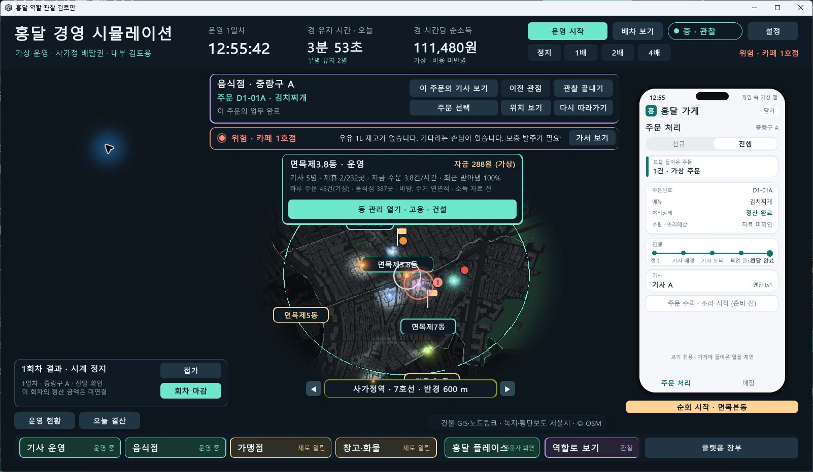
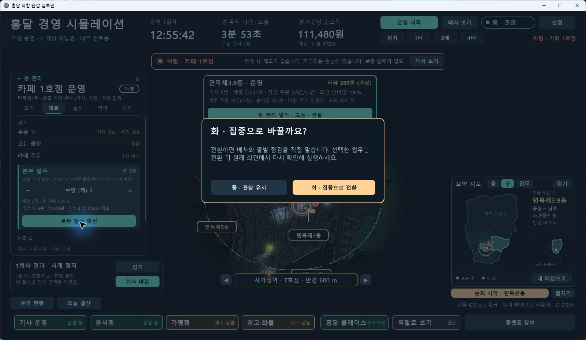

# 같은 주문의 역할 관찰과 중화 모드

11월 16일 최종 Windows 검토판의 실제 화면이다. 동 지도 아래 「역할로 보기」에서 음식점·음식 배달기사·센터·화물을 고르고 같은 업무의 상대에게 관점을 넘긴다. 관찰을 끝내면 원래 지도·선택으로 돌아온다. 기존 동 관리의 고용·건설 진입도 유지한다.

중에서는 지도 이동과 확대를 해도 맡김이 이어진다. 직접 업무 버튼을 누르면 화 전환을 확인하고, 전환 뒤 원래 화면에서 해당 일을 다시 확인한다. 모드 안내를 취소하면 업무 명령이 나가지 않는다.

최종 빌드는 오류·경고 0, 기본 409개 통과다. 전용 146개는 마지막 금색 단추 글씨 수정 전 판본에서 통과했다. 실제 Windows 관점 전환·중화 복귀·추적 중지와 재실행 후 결과 복원을 확인했다. 여러 물류 건의 전체 클릭 완주는 후속이다. 검토판은 일반판과 저장 프로필을 나눴다. 커밋·푸시하지 않았다.

[구현 반환과 정확한 검증 범위](../AI/Handoffs/2026-11-16-Codex-역할관찰-중화모드-인계반환.md)
