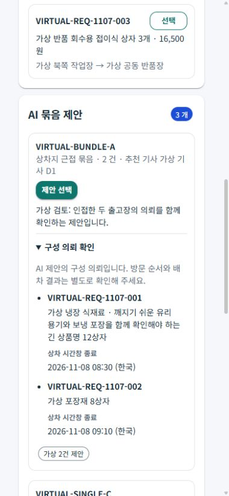

# SsalddelAdmin-P37 - 국내화물 AI 배차 검토

[전체 화면 문서](../../README.md) / [SsalddelAdmin 화면 목록](../README.md) / [앱 전체 카탈로그](../../../app-page-catalog.md)

## 화면 캡처

2026-11-08 · 실제 Admin InteractiveServer · 앱 내 브라우저390px · 가상 의뢰3건·제안3개. **로그인** 뒤 같은 검토로 돌아와 **구성 의뢰 확인**으로 12상자·8상자와 상차 시간창 종료를 읽는다. [로그인 복귀·실제 전후·한계](../../../../Changes/2026-11-08-admin-login-return.md). [2026-11-07 구판 정적 렌더](../../../../assets/changes/2026-11-07-operator-bundle-members/bundle-members-390.png)와 [직전 실제 웹](../../../../Changes/2026-11-08-admin-platform-startup.md)은 보존한다.

## 기본 정보

| 항목 | 내용 |
| --- | --- |
| 앱 | SsalddelAdmin |
| 페이지 ID / 제목 | SsalddelAdmin-P37 - 국내화물 AI 배차 검토 |
| 라우트 | 현행 진입 `/admin/freight-delivery/dispatch-ai-review` · 기존 선언 `/dispatch/ai-review`는 현재 navigation policy와 구별 |
| 소스 파일 | [SsalddelAdmin/Components/Pages/DomesticCargoDispatchAIReview.razor](../../../../../SsalddelAdmin/Components/Pages/DomesticCargoDispatchAIReview.razor) |
| 분류 | 운영 |
| 2.0 운송 필수 연결 | 운영 보조 |
| 캡처 상태 | 완료 |

## 왜 필요한가

### 페이지 책임

| 항목 | 기록 |
| --- | --- |
| 사용자·질문 | 운영자가 현재 AI 묶음 제안에 어떤 의뢰가 포함됐는지와 추천 근거를 확인하는가 |
| 주 행동 | 기존 **제안 선택**으로 해당 의뢰와 추천 기사를 대조하고 기존 판단 기록에서 승인·보류를 남김 |
| 구성 확인 | **구성 의뢰 확인**에서 현재 조회의 같은 RequestId, 화물 내용, 확인된 상차 시간창 종료를 읽음 |
| 정보의 의미 | AI 제안 구성과 추천 기사는 실제 확정 배차·담당자가 아님. 표시 순서는 방문 순서가 아니며 건수와 물량을 추정해 합치지 않음 |
| 원천·미확인 | 기존 workspace GET의 Bundles.RequestIds와 Requests만 연결. 현재 조회에 없거나 중복·모호한 연결은 확인 필요, 없는 시각은 미확인 |
| 동작·복귀 | 구성 펼치기는 조회·선택·저장 명령을 실행하지 않음. 기존 지도·의뢰 선택·재조회·판단 저장·인증/실패/빈 상태는 보존 |
| 구현·검증 | 기존 카드의 작은 읽기 영역. 실제 Razor 30사례와 기존 서비스 1사례, 가상 정상·단건·두 건·미확인 구성과 320px·390px·1280px의 정적 렌더·native 펼치기를 검증. C# 브라우저 이벤트·운영은 별도 |

국내화물 배차에서 AI가 만든 묶음 제안, 기사 위치, 상차지와 하차지를 운영자가 같은 화면에서 확인하기 위해 필요하다. 운영자는 제안을 바로 승인하거나 보류하고, 수동 판단을 남겨 이후 배차 판단 사례로 축적할 수 있다.

## 사용자와 참여자

주 사용자: 관리자, 운영자 / 보조 참여자: 기사, 화주, 배차 담당자

이 화면은 배차 엔진의 판단을 그대로 통과시키기보다, 운영자가 근거를 보고 예외를 잡아내는 검토 표면이다. 실제 기사 배정과 운송 상태 전이는 서버 배차 흐름에서 처리한다.

## 화면에서 다루는 일

- 주 책임: 국내화물 AI 배차 묶음 검토와 운영자 승인/보류 판단
- 사용자가 확인해야 하는 것: 상차/하차 위치, 기사 위치, 묶음 점수, 예상 거리, AI 판단 근거
- 사용자가 조작해야 하는 것: 묶음 선택, 승인/보류/수동 묶음 판정, 판단 메모 입력
- 화면 밖으로 넘길 일: 운송 상태 전이, 기사 정산, 문서 검수는 관련 운영 화면에서 처리한다.

## 다른 화면과의 관계

- 이전 화면: [SsalddelAdmin-P36 - 연락처 통합 검색](../SsalddelAdmin-P36/)
- 다음 화면: [SsalddelAdmin-P38 - 음식배달 AI 배차 검토](../SsalddelAdmin-P38/)
- 함께 보는 화면: [SsalddelAdmin-P19 - 배차대기/추천 잠금 상태](../SsalddelAdmin-P19/), [SsalddelAdmin-P22 - 운송 상세 원장](../SsalddelAdmin-P22/), [SsalddelAdmin-P39 - 배차 AI 판단 사례](../SsalddelAdmin-P39/)
- 상위 화면: 없음
- 하위 화면: 없음

승인 또는 보류 결과는 배차 판단 사례로 남겨 [SsalddelAdmin-P39](../SsalddelAdmin-P39/)에서 다시 확인하고, 운송 원장에서는 실제 운송 상태와 증빙 흐름을 확인한다.

## API 경로와 코드 연결

- 화면 소스: [SsalddelAdmin/Components/Pages/DomesticCargoDispatchAIReview.razor](../../../../../SsalddelAdmin/Components/Pages/DomesticCargoDispatchAIReview.razor)
- 클라이언트 서비스: [SsalddelAdmin/Services/DomesticCargoDispatchAIReviewAdminService.cs](../../../../../SsalddelAdmin/Services/DomesticCargoDispatchAIReviewAdminService.cs)
- 서버 계약: [Ssalddel.Contracts/Admin/Dispatch/DomesticCargoDispatchAIReviewDtos.cs](../../../../../Ssalddel.Contracts/Admin/Dispatch/DomesticCargoDispatchAIReviewDtos.cs)
- 서버 컨트롤러: [Ssalddel/Controllers/Admin/Dispatch/국내화물배차AI검토Controller.cs](../../../../../Ssalddel/Controllers/Admin/Dispatch/국내화물배차AI검토Controller.cs)

| 구분 | 메서드 | API 경로 | 클라이언트/문서 근거 | 서버 근거 |
| --- | --- | --- | --- | --- |
| 검토 작업공간 | GET | `api/v1/admin/dispatch/domestic-cargo-ai-review` | [DomesticCargoDispatchAIReviewAdminService.cs](../../../../../SsalddelAdmin/Services/DomesticCargoDispatchAIReviewAdminService.cs) | [국내화물배차AI검토Controller.cs](../../../../../Ssalddel/Controllers/Admin/Dispatch/국내화물배차AI검토Controller.cs) |
| 운영자 판단 기록 | POST | `api/v1/admin/dispatch/domestic-cargo-ai-review/decisions` | [DomesticCargoDispatchAIReviewAdminService.cs](../../../../../SsalddelAdmin/Services/DomesticCargoDispatchAIReviewAdminService.cs) | [국내화물배차AI검토Controller.cs](../../../../../Ssalddel/Controllers/Admin/Dispatch/국내화물배차AI검토Controller.cs) |

검증할 때는 `AdminData:UseMemory=true`에서 샘플 데이터가 먼저 렌더링되고, 실제 API 모드에서는 관리자 인증 토큰이 붙은 요청으로 같은 구조의 DTO를 받는지 확인한다.

조회 실패에서는 **다시 조회**를 제공하고 지도와 판단 양식을 닫는다. 정상 응답에 의뢰가 없으면 빈 결과를 표시한다. 320px·390px 브라우저에서 합성 응답으로 확인했다. [변경·검증 기록](../../../../Changes/2026-11-06-operator-dispatch-review-read-state.md)

320×844px 가상 화면에서는 지도 아래 첫 의뢰의 운임, 상·하차 경로, **선택**을 첫 화면에서 확인할 수 있다. **선택**은 같은 의뢰의 지도 핀 강조를 바꾼다. [가상 의뢰 390px 캡처와 검증](../../../../Changes/2026-11-07-operator-dispatch-map-height.md)

AI 묶음 제안은 기존 `RequestIds`를 현재 `Requests`와 정확히 연결해 **구성 의뢰 확인**에 표시한다. 순서는 방문 순서가 아니고 **추천 기사**는 확정 배정이 아니다. 참조가 누락·중복되거나 현재 의뢰가 모호하면 원시 미확인 번호 대신 연결 확인 안내를 남긴다. 시간창은 계약에 있는 종료 시각만 한국 시각으로 표시하며 없는 값은 미확인이다. [현재 구성 컴포넌트](../../../../../SsalddelAdmin/Components/DispatchTraining/DomesticCargoBundleMembers.razor) · [현재 검증과 한계](../../../../Changes/2026-11-07-operator-bundle-members.md)

### 재조회 뒤 기사 선택 · 2026-11-07

현재 응답에서 정확히 한 번 확인되는 기사만 선택·버튼/지도 강조·판단 요청에 사용한다. 추천이 없으면 현재 목록에 남은 기존 선택은 유지하고 사라진 선택은 비운다. **기사 선택**에서 현재 기사를 선택한 뒤 **RAG 판단 사례로 저장**을 사용한다. 이는 현재 화면의 선택 정합성 검사이며 배차 확정이나 서버의 기사 자격 판정을 바꾸지 않는다.

실제 부모 이벤트·클라이언트 서비스·메모리 HTTP 요청 25사례에서 버튼·핀과 저장 본문을 대조했다. 외형·기존 대표 캡처는 유지하며 실제 브라우저 조작·서버 저장·기기는 이번에 확인하지 않았다. [수정 전 실패·구현·마감 검증](../../../../Changes/2026-11-07-operator-driver-selection.md)

### 판단 저장 중 새 메모 · 2026-11-07

**판정 메모**는 입력 시 화면의 편집 값에 반영한다. **RAG 판단 사례로 저장**으로 보낸 메모 A의 응답을 기다리며 B를 작성하면, 성공 뒤 B를 유지해 다음 명시 저장에서 보낼 수 있다. 변경 없는 제출 메모는 성공 뒤 비우고 실패 시 최신 입력을 보존한다. 입력마다 판단 사례를 저장하지 않으며 기존 선택·중복 저장 방지는 유지한다.

실제 부모·Mud 입력 C# 핸들러·바인딩·textarea 출력·지연 메모리 HTTP 12사례에서 제출 본문과 새 입력을 대조했다. 등록된 DOM 이벤트·실제 브라우저의 타이핑/포커스·서버 저장·기기 검증과 구분한다. [실패 재현·수정·마감 범위](../../../../Changes/2026-11-07-operator-memo-preservation.md)

## 보안과 개인정보 점검

지도 좌표, 기사 위치, 화주 주소가 함께 보이므로 실제 운영 캡처에는 개발용 샘플 데이터나 마스킹 데이터를 사용한다. 운영자 판단 기록은 감사 대상이므로 사용자 식별자, 판단 시각, 승인/보류 사유가 서버 로그와 연결되어야 한다.

## 캡처와 문서 상태

2026-11-07 구판 캡처는 실제 컴파일된 페이지·구성 컴포넌트와 격리 합성 GET 응답을 연결한 정적 렌더다. 실제 로그인·서버·DB나 InteractiveServer 시작, C# 업무 버튼을 실행한 결과와 구분한다. 구성을 펼칠 때 추가 조회·쓰기 없이 native 펼치기만 브라우저에서 대조했다.

[이전 전체 카탈로그 캡처](../../../assets/app-pages/SsalddelAdmin/SsalddelAdmin-P37.png)와 [이전 지도·의뢰 캡처 기록](../../../../Changes/2026-11-07-operator-dispatch-map-height.md)은 원본 위치에 보존한다.

## 보완 메모

- 실제 지도 SDK가 붙으면 문서 캡처에서 좌표, 주소, 기사 위치 마스킹 정책을 다시 확인한다.
- AI 판단 사례 저장 정책이 바뀌면 [SsalddelAdmin-P39](../SsalddelAdmin-P39/)의 사례 문서와 함께 갱신한다.
- 이 화면이 2.0 운송 필수 배차 운영 범위로 올라가면 ssalddel-v1-required-pages.md에도 반영한다.

## 2026-11-08 현재 실제 웹 확인

현재 허용 진입은 `/admin/freight-delivery/dispatch-ai-review`다. 기존 `/dispatch/ai-review` route 선언과 현행 navigation policy를 구별한다. 실제 Admin의 시작 누락을 좁게 보완하고 현재 기사 선택·같은 의뢰 구성·저장 중 새 메모를 앱 내 브라우저390/320/1280px에서 확인했다. [실제 웹·원본·가상자료와 한계](../../../../Changes/2026-11-08-admin-platform-startup.md)를 따른다. 이전 대표 화면의 정적 렌더 범위는 위 설명대로 보존한다.

## 로그인 복귀 후속 (2026-11-08)

미로그인 진입과 조회401의 기존 로그인 링크를 현행 허용 경로로 맞췄다. 옛 route 선언·정책 차단·403 권한 구분은 유지한다. 합성 폼 로그인200과 401 뒤 기존 세션의 자동 복귀를 실제 브라우저에서 별도로 확인했다. [수정 전후9쌍과 기록](../../../../../artifacts/local/admin-login-return-20261108-1520/comparison.html)을 따른다. 비교 HTML의 파일 주소는 도구 정책으로 열지 못했고 원본·링크는 정적으로 검증했다. 실제 제품 화면의 클릭·입력 검증과 구별한다.
