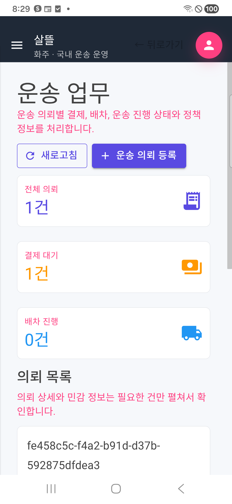

# SsalddelApp-P09 - 운송 업무 워크스페이스

[전체 화면 문서](../../README.md) / [SsalddelApp 화면 목록](../README.md) / [통합 클라이언트 가이드](../../../unified-community-client.md)

## 화면 캡처

2026-11-03 검토 APK141을 실제 USB 휴대폰에 설치해 같은 의뢰의 조회·목록 유지·최초 실패·복귀를 확인했다. 로컬 제품 API·격리 DB의 합성 `Simulation` 화면이며 원격 운영 검증과 구분한다. [APK141 화면·통신/인증 시험·남은 한계](../../../../Changes/2026-11-03-cargo-communication-resilience-r2.md). [이전 APK140 전후 근거](../../../../Changes/2026-11-03-physical-app-server-validation-r1.md)는 보존한다.

## 기본 정보

| 항목 | 내용 |
| --- | --- |
| 라우트 | `/shipper/transport` |
| 내비게이션 단계 | 3단계 데이터 페이지 |
| 목표 진입 문맥 | 운송 다이어그램의 `운송` 또는 `운송 의뢰` 노드 행동 |
| 소스 | [TransportWorkspace.razor](../../../../../SsalddelApp/Components/Pages/TransportWorkspace.razor) |
| 분류 | 필수 |
| 캡처 | 실제 APK141 · 합성 업무 조회/실패/복귀 |

## 왜 필요한가

홈은 현재 상태와 업무 진입을 요약한다. 이 화면은 내 운송 의뢰를 찾아 현재 상태와 다음 확인을 보고, 선택한 의뢰의 기존 상세로 이동하는 목록이다. 긴 주소·결제 수단·등록 정보는 상세에서 확인한다.

## 사용자와 화면 책임

주 사용자는 화주다. 로그인된 사용자의 운송 의뢰를 조회하고, 상태별 다음 확인, 요약·진행 이력·결제 확인, 새 의뢰 등록으로 연결한다. 창고·판매·통관 처리는 각각의 전용 워크스페이스로 넘긴다.

### 요약 목록과 기존 상세 연결 (2026-11-05)

| 항목 | 책임 |
| --- | --- |
| 한 문장 목적 | 화주가 내 의뢰를 찾아 현재 상태와 다음 확인을 판단하고 같은 의뢰의 상세로 이동한다. |
| 기본 표시 | 화물 종류·적재 형태·의뢰 ID, 의뢰/결제/배차 상태, 결제 예정액, 다음 확인. 금액이 없으면 미확인이며 실제0원과 구분한다. |
| 보조 정보 | 기존 상세에 없는 알선 조건과 기준 운임/기사 지급 예정은 ‘요금·알선 조건’ 펼침에 보존한다. 현재 모델의 값이며 새로운 산식·정책 판정은 만들지 않는다. |
| 상세로 인계 | 같은 ID의 요약, `/timeline` 진행 이력, `/payment` 결제 확인. 등록 시각·주소·결제 수단의 중복 표시를 목록에서 덜어낸다. |
| 주 행동 | 결제 확인이 필요한 기존 `CanPay` 상태는 결제 확인, 나머지는 상세 보기. 진행 이력은 보조 이동이다. |
| 경고·개인정보 | 정책 플래그 또는 경고 목록이 있으면 경고 내용을 접기 밖에 표시한다. 기본false/빈값만으로 정책 정상을 단정하지 않는다. 목록의 주소·연락 대상 문자열 노출을 제거한다. |
| 진입·복귀 | 기존 `ShipperRequestDetailNavigationContext`로 목록 복귀 주소를 전달한다. 두 번째 이후 페이지에서는 `page`를 함께 전달해 같은 페이지를 다시 조회한다. 빈 의뢰 ID의 링크는 만들지 않는다. |
| 실행 경계 | 결제 확인 링크는 기존 결제 화면으로 이동만 한다. 결제/시험 결제는 상세 화면의 별도 명시 동작이며 목록에서 실행·자동 재전송하지 않는다. |

목록의 재조회·로그아웃·이탈 수명은 아래 기존 구현을 유지한다. 원본 Razor 상태/이동 회귀·소비 빌드와 새 휴대폰의 실제 화면 확인은 별도다. [이번 보완과 검증 범위](../../../../Changes/2026-11-05-shipper-transport-summary-r1.md)를 따른다. 기존 APK141 캡처는 이전 목록이며 이번 수정의 새 기기 검증으로 사용하지 않는다.

한 페이지에 50건이 차면 하단의 **이전 의뢰 보기**로 오래된 의뢰를 다시 읽을 수 있다. 두 번째 이후 페이지에는 **최신 쪽 보기**도 표시한다. 집계는 현재 페이지 기준이다. 다음 페이지가 비었거나 조회가 실패하면 이미 확인한 목록을 유지한다. 같은 등록 시각은 서버의 고유 행 순서로 정렬하며, 페이지 사이의 새 등록·삭제는 목록 위치에 영향을 줄 수 있다.

### 조회·복귀 책임 (2026-10-03)

목록의 초기·수동·SignalR·주기 갱신은 [ShipperQueryLifetime](../../../../../SsalddelApp/ViewModels/Shipper/ShipperQueryLifetime.cs)으로 직렬화한다. 최신 요청·현재 로그인 수명·화면 수명이 모두 맞는 결과만 표시한다. 로그아웃 시 이전 의뢰 목록을 비우고 로그인 안내로 돌아간다. 의뢰별 입력·모의 결제 안내·운송 상태의 상세 책임은 [의뢰 상세](../SsalddelApp-P03/)에 남긴다. [보완 범위·시험 경계](../../cargo-workflow-recovery-r1.md).

### 최초 조회와 실패 표시 (2026-11-03)

조회 중에는 진행 상태를 표시하고 수동 새로고침을 막는다. 성공한 조회 전에는 0건 집계를 만들지 않고, 정상 빈 응답에만 빈 목록 안내를 표시한다. 재조회 실패 때는 마지막 성공 목록과 경고를 유지한다. 기존 최신 조회/세션/이탈 보호는 그대로 쓰며 로그아웃·세션 무효화 때 표시 상태도 함께 비운다. 실제 APK141에서는 서버 중단 중 마지막 의뢰1건 유지와 새 화면의 오류만 표시를 각각 확인했고, 같은 DB 재개 뒤 재로그인 없이 동일 의뢰로 복귀했다.

## API와 보안

`IShipperOperationsService`로 의뢰 목록을 읽고 같은 의뢰의 기존 상세 화면으로 이동한다. 비로그인 사용자는 데이터 대신 홈 로그인 안내를 본다. 주소·연락처·결제 수단의 목록 반복 노출은 제거하며 상세의 기존 권한·표시 경계를 따른다.

### 통신 응답과 인증 경계 (2026-11-03)

[서버 연결 서비스](../../../../../SsalddelApp/Services/ServerBackedShipperOperationsService.cs)는 정상 배열 `[]`와 `null`·빈 본문·잘못된 JSON·null 항목을 구분한다. 확인할 수 없는 목록을 정상 빈 목록으로 표시하지 않으며, 연결 실패·시간초과·HTTP 오류는 원시 서버 본문이나 요청경로를 노출하지 않는 안내로 전달한다. 사용자의 취소와 내부 시간초과는 구분하고 등록 POST는 자동 반복하지 않는다.

로그인·로그아웃·토큰 저장은 현재 인증 의도와 세션 판본에 맞는 결과만 적용한다. 인증 저장 후 선택적 부가 조회가 실패해도 로그인을 실패로 바꾸지 않는다. [가상 응답·인증 경합·실제 기기 검증 기록](../../../../Changes/2026-11-03-cargo-communication-resilience-r2.md)에서 코드 시험과 실제 서버·휴대폰 확인을 구분한다.

## 다른 화면과의 관계

- 이전: [SsalddelApp-P01 화주 홈](../SsalddelApp-P01/)
- 다음: [SsalddelApp-P02 운송 의뢰 작성](../SsalddelApp-P02/), [SsalddelApp-P03 의뢰 상세](../SsalddelApp-P03/)
- 목표 흐름: 사방괘에서 운송 영역 선택 → 운송 다이어그램 → 운송 노드의 `운송 업무` 행동 → 이 페이지
- 돌아가기: 출발 다이어그램의 선택 노드, 스크롤·확대, 레이어 상태를 복원한다.
