# 역할별 화면 둘러보기

역할마다 화면에서 먼저 읽을 정보와 다음에 누를 버튼을 함께 소개합니다. 이미지를 누르면 원본 크기로 볼 수 있습니다.

아래는 서로 다른 날짜·판본의 대표 검토 화면입니다. 캡처의 ‘살뜰’은 이전 앱 표시명이며 현재 프로젝트 이름은 Mirror입니다. 실제 휴대폰·에뮬레이터·모바일 웹 예시를 구분했고, 표시된 업무는 합성 시험 자료입니다. 현재 완성 범위는 [통합 1.0 업무별 마감표](../Versions/unified-1.0/checklist.md)에서 확인합니다.

### 화주 — 진행 중인 의뢰와 다음 확인

<a href="../assets/changes/2026-10-26-cargo-android-recovery-r124/shipper-summary.png">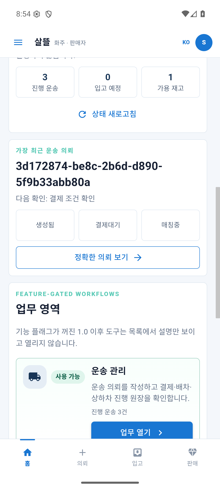</a>

2026-10-26 · Android 에뮬레이터 검토 APK 화면 · [당시 검증 기록](../Changes/2026-10-26-cargo-android-recovery-r124.md)

- **보는 정보:** 진행 운송·입고 예정·가용 재고, 최근 의뢰의 결제 대기·매칭 상태와 다음 확인 사항.
- **행동과 연결:** `정확한 의뢰 보기`에서 해당 의뢰를 확인하고, `업무 열기`로 운송 관리에 들어갑니다.
- **검토 질문:** 여러 의뢰가 있어도 지금 확인할 건과 다음 행동을 바로 찾을 수 있는가?

의뢰 상세에서는 긴 화물명과 운송 상태를 읽고, **돌아가기**로 확인하던 목록 페이지를 엽니다. 2026-11-06 · 390px 브라우저 · 가상 의뢰. [긴 화물명이 줄바꿈된 의뢰 상세](../assets/changes/2026-11-06-shipper-detail-cargo-name-wrap/detail-390.png) · [검증 기록](../Changes/2026-11-06-shipper-detail-cargo-name-wrap.md)

같은 의뢰의 **경로**에서는 상·하차 시설명을 읽고, **비용·조건**에서 결제 예정액과 최종 운임을 확인합니다. 2026-11-07 · 390px 브라우저 · 가상 의뢰. [시설명과 두 운임이 보이는 상세](../assets/changes/2026-11-07-shipper-route-word-wrap/route-cost-390.png) · [주소 줄바꿈 검증](../Changes/2026-11-07-shipper-route-word-wrap.md)

통합 화주의 지도 연결 안내에서 **목록으로 보기**를 누르면 현재 의뢰가 선택된 운송 목록이 열립니다. 목록에서 다른 의뢰를 골라 상태·수량·운임을 확인할 수 있습니다. 2026-11-07 · 390px 로컬 브라우저 · 가상 의뢰. [목록 전환 화면](../assets/changes/2026-11-07-shipper-map-unconfigured-list/shipper-390.png) · [검증 기록](../Changes/2026-11-07-shipper-map-unconfigured-list.md)

### 화주 — 사진 입고 신청을 이어서 작성

사진이나 이름을 입력한 뒤 **새 사진 신청**을 누르면 확인 창이 열립니다. **계속 작성**으로 기존 사진과 이름이 있는 화면으로 돌아가고, **입력 비우고 시작**으로 새 신청을 준비합니다. [2026-11-07 가상 사진의 390px 화면과 검증](../Changes/2026-11-07-photo-inbound-draft-reset.md)

### 화물 기사 — 한 건의 추천을 보고 수락·거절 판단

<a href="../assets/changes/2026-10-24-cargo-single-recommendation/driver-single.png">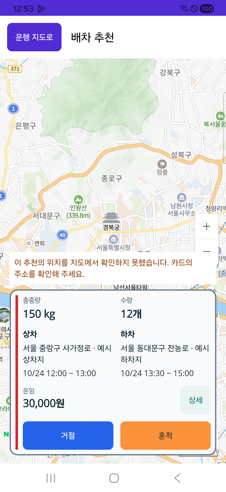</a>

2026-10-24 · 실제 휴대폰 검토 APK 화면 · [단건 추천의 동작·검증 범위](../Changes/2026-10-24-cargo-single-recommendation.md)

- **보는 정보:** 총중량·수량, 왼쪽 상차와 오른쪽 하차의 장소·시간, 운임과 운송 방식.
- **행동과 연결:** `상세`로 조건을 펼치고, 제안의 독차·혼적 방식에 맞춰 수락하거나 거절합니다. `운행 지도로`는 현재 업무 확인으로 돌아가는 진입입니다.
- **검토 질문:** 수락 전에 필요한 조건을 빠짐없이 읽고 판단할 수 있는가? 이 캡처는 좌표 미확인 안내 상태이므로 정확한 핀·실도로 경로를 검증한 화면으로 보지 않습니다.

<a href="../assets/changes/2026-11-07-driver-current-transport-metrics/on-road-390.png">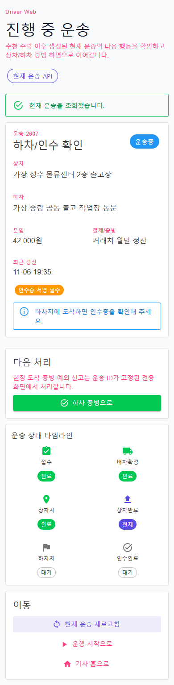</a>

추천 수락 뒤 **진행 중 운송**에서 상·하차지, 운임과 결제 방식, 인수증 안내를 확인합니다. 운송 중에는 **하차 증빙으로**를 눌러 해당 운송의 증빙 화면을 엽니다. 2026-11-07 · 390px 브라우저 · 가상 운송. [현재 운송 화면 검증](../Changes/2026-11-07-driver-current-transport-metrics.md) · [증빙 버튼 배치 검증](../Changes/2026-11-06-driver-current-transport-action.md)

#### 상차 확인에서 현장 사진 선택

<a href="../assets/changes/2026-11-07-cargo-pickup-photo-selector/pickup-390.png">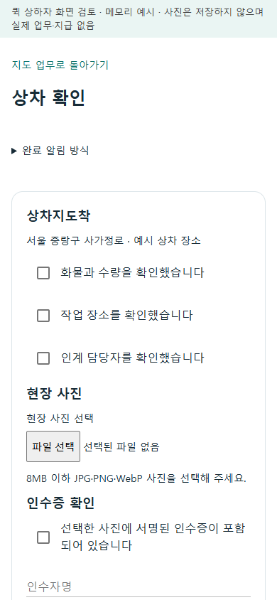</a>

**상차 확인**에서 현장 확인 항목을 읽고 **파일 선택**으로 사진을 고릅니다. 사진을 고르면 같은 화면에서 파일명을 확인할 수 있습니다. 2026-11-07 · 390px 로컬 브라우저 · 가상 운송. [상·하차 사진 선택 검증](../Changes/2026-11-07-cargo-pickup-photo-selector.md)

### 화물 기사 — 추천 알림 예시 확인

**음식 배달 추천**과 **화물 운송 추천 (퀵 포함)** 아래에서 받을 알림의 예시를 확인합니다. **다시 조회**를 누르면 같은 계정의 설정을 다시 불러옵니다. [2026-11-07 가상 설정의 390px 화면과 검증](../Changes/2026-11-07-driver-alert-example-wrap.md)

### 통합 기사 — 지금 할 일과 조회 복구

<a href="../assets/changes/2026-11-07-driver-work-retry-near-error/recovered-390.png">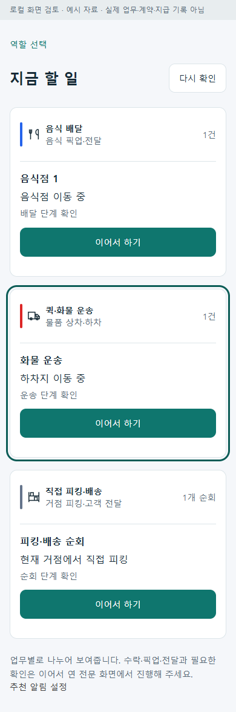</a>

카드에서 업무의 종류와 현재 단계를 읽습니다. 조회 오류 카드에서 **전체 업무 다시 확인**을 누르면 세 업무를 다시 불러오고, **이어서 하기**로 해당 업무 화면을 엽니다. 2026-11-07 · 390px 로컬 브라우저 · 가상 업무. [재조회와 키보드 검증](../Changes/2026-11-07-driver-work-retry-near-error.md)

### 음식점 — 메뉴의 가격과 판매 상태 확인

<a href="../assets/changes/2026-11-06-restaurant-menu-readability/menus-390.png">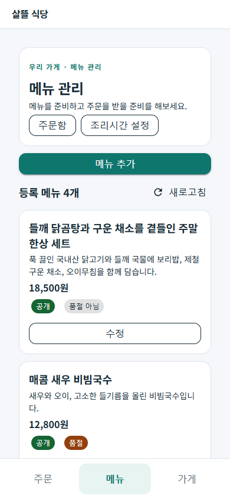</a>

메뉴 카드에서 가격과 **공개·품절** 상태를 읽습니다. **수정**을 누르면 해당 메뉴의 가격과 공개 스위치를 확인할 수 있고, **목록으로 · 입력 취소**를 누르면 목록으로 돌아갑니다. 2026-11-06 · 모바일 폭 브라우저 · 가상 메뉴 4건. [가격과 공개 스위치가 보이는 메뉴 수정 화면](../assets/changes/2026-11-06-restaurant-menu-editor-guidance/editor-390.png) · [편집 화면 검증](../Changes/2026-11-06-restaurant-menu-editor-guidance.md) · [메뉴 목록 검증](../Changes/2026-11-06-restaurant-menu-readability.md)

**새로고침**에 실패하면 마지막 조회 결과가 표시된다는 안내를 확인할 수 있습니다. 처음 불러오지 못한 경우에는 첫 조회 실패를 별도로 안내합니다. [2026-11-07 가상 메뉴 조회와 복구 검증](../Changes/2026-11-07-restaurant-menu-read-failure-copy.md)

### 음식점 — 조리·픽업 준비 확인

공통 업무 화면에서 **상세**를 누르면 주문의 조리 회차, 준비 예정 시각, 준비 완료 여부가 보입니다. **접기**를 누르면 같은 주문의 요약으로 돌아갑니다. [390px 브라우저의 가상 주문 상세와 검증](../Changes/2026-11-07-role-map-detail-label-wrap.md)

### 음식 기사 — 음식점 도착부터 픽업 완료까지

<a href="../assets/changes/2026-10-16-phone-ui-progress/10-food-pickup.png">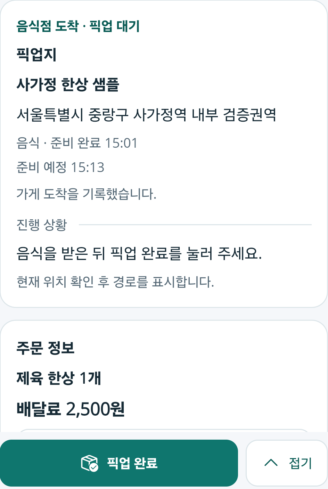</a>

2026-10-16 · 실제 휴대폰 화면의 카드 부분 · [픽업·전달 화면과 검증 기록](../Changes/2026-10-16-phone-ui-progress-summary.md)

- **보는 정보:** 현재 단계, 픽업 매장, 음식 준비 상태·시각, 주문 메뉴와 배달료.
- **행동과 연결:** 음식을 받은 뒤 `픽업 완료`를 선택하고 전달 단계로 이어집니다. 픽업과 전달 화면은 같은 업무의 단계별 정보와 행동을 보여 줍니다.
- **검토 질문:** 대기 중인 이유와 지금 누를 버튼이 분명한가? 준비 상태와 예정 시각을 혼동하지 않는가?

#### 통합 앱의 픽업 대기

<a href="../assets/changes/2026-11-07-food-driver-pickup-guide/pickup-waiting-390.png">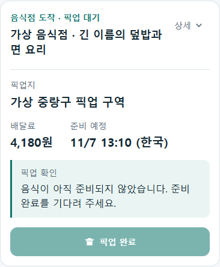</a>

**픽업 확인**에서 음식 준비를 기다리는 이유를 읽습니다. 픽업이 허용되면 **픽업 완료**가 활성화되며, 음식을 받은 뒤 다음 전달 단계로 이어갑니다. 2026-11-07 · 390px · 가상 배달을 불러온 공용 화면의 정적 검토. [안내와 검증 범위](../Changes/2026-11-07-food-driver-pickup-guide.md)

### 음식 기사 — 완료 배달의 주문 정보 확인

**완료 배달 내역**에서 배달을 선택하면 상세의 **주문 정보**에서 메뉴·수량과 주문금액을 읽을 수 있습니다. **내역 목록**을 누르면 같은 날짜의 완료 배달 목록으로 돌아갑니다. [2026-11-07 가상 배달의 390px 화면과 검증](../Changes/2026-11-07-food-driver-order-menu-indent.md)

### 주문자 — 주문 진행과 위치 정보의 시점 확인

<a href="../assets/changes/2026-10-05-role-map-reliability-r16/orderer-progress.jpg">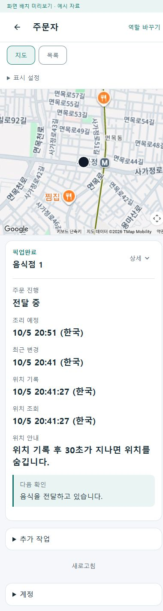</a>

2026-10-05 · 모바일 폭 브라우저의 공통 UI 예시 · [상태·위치 표시 기준과 검증](../Changes/2026-10-05-role-map-reliability-r16.md)

- **보는 정보:** 주문의 현재 단계, 조리 예정·최근 변경 시각, 위치 기록·조회 시각과 다음 안내.
- **행동과 연결:** `상세`에서 해당 주문을 살펴보고 새로고침으로 진행 상태를 다시 확인합니다. 위치 정보는 기록 시점과 표시 기한을 함께 읽습니다.
- **검토 질문:** 주문 진행과 위치 정보가 얼마나 최신인지 각각 구분할 수 있는가?

#### 음식 주문 목록에서 주문 찾기

<a href="../assets/changes/2026-11-06-orderer-food-history-layout/orders-390.png">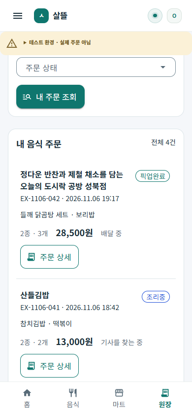</a>

**내 음식 주문**의 카드에서 음식점·금액·진행 상태를 확인합니다. **주문 상세**를 누르면 배달 중인 주문의 상태와 금액이 상단에 표시되고, **주문 목록**을 누르면 목록으로 돌아갑니다. 2026-11-06 · 모바일 폭 브라우저 · 가상 주문. [배달 중 표시와 금액이 보이는 주문 상세](../assets/changes/2026-11-06-orderer-detail-delivery-summary/detail-390.png) · [상세 화면 검증](../Changes/2026-11-06-orderer-detail-delivery-summary.md) · [음식 주문 목록 검증](../Changes/2026-11-06-orderer-food-history-layout.md)

주문 취소 결과를 확인하지 못했을 때 **결과 다시 확인**은 주문 상태를 조회합니다. **같은 요청 재시도**는 조회가 성공해도 반영이 확인되지 않으면 같은 내용으로 다시 요청합니다. [2026-11-07 가상 주문으로 확인한 두 행동](../Changes/2026-11-07-orderer-cancel-retry-label.md)

### 판매자 — 출고 후보에서 주문 찾기

<a href="../assets/changes/2026-11-07-seller-mobile-label-wrap/orders-390.png">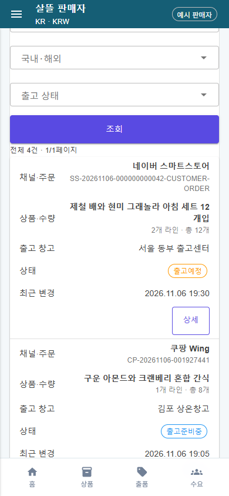</a>

상단에서 계정 이름을 확인하고, 주문번호·상품·SKU로 **조회**한 뒤 **상세**를 열면 주문 요약과 출고 후보를 확인할 수 있습니다. **주문 목록**으로 돌아오면 검색 조건이 유지됩니다. 2026-11-07 · 390px 브라우저 · 가상 주문 4건. [주문 상태와 요약이 보이는 상세](../assets/changes/2026-11-07-seller-account-contrast/detail-390.png) · [계정 표시 검증](../Changes/2026-11-07-seller-account-contrast.md) · [상세 화면 검증](../Changes/2026-11-07-seller-order-detail-metrics.md) · [모바일 목록 검증](../Changes/2026-11-07-seller-mobile-label-wrap.md)

#### 통합 웹 — 빈 페이지에서 주문 다시 찾기

<a href="../assets/changes/2026-11-07-seller-current-page-empty/recovered-order41-390-full.png">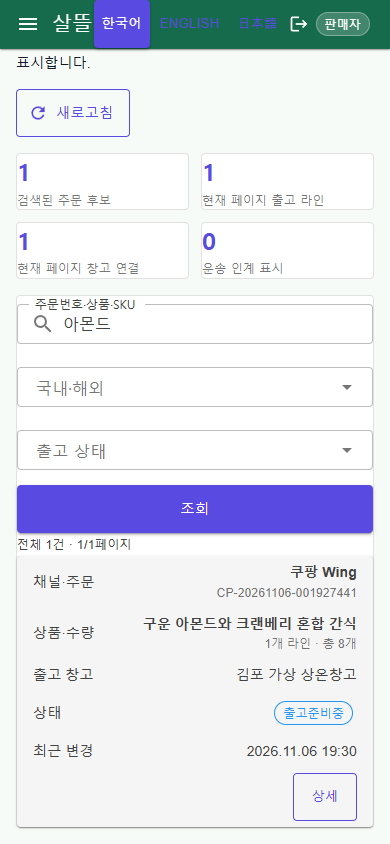</a>

현재 페이지만 비었을 때 **첫 페이지 조회**를 누르면 입력한 조건으로 주문을 다시 찾습니다. 복구된 주문의 **상세**에서 같은 구성·수량을 확인하고 **주문 목록으로** 돌아올 수 있습니다. 2026-11-07 · 통합 웹 실제 Chrome 390px · 가상 주문. [수정 전후 비교](../../artifacts/local/seller-current-page-empty-20261107/comparison/comparison.html) · [웹·휴대폰 검증과 판본](../Changes/2026-11-07-seller-current-page-empty.md)

#### 통합 웹 — 상세에서 조회했던 목록으로 돌아오기

<a href="../assets/changes/2026-11-08-seller-applied-query-return/orders-1280-full.png">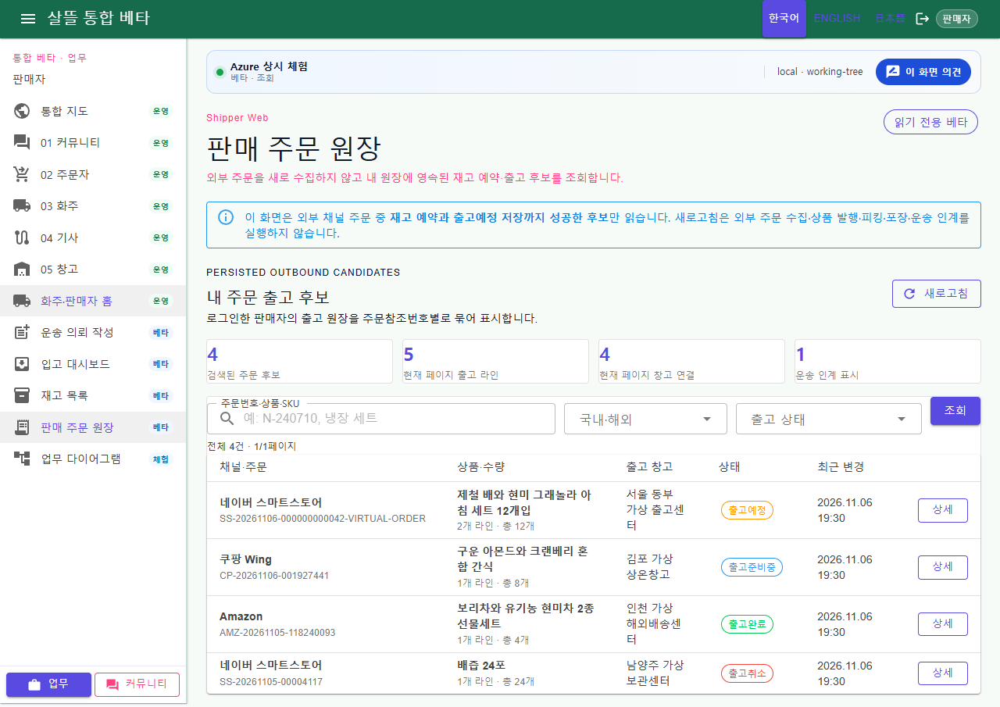</a>

검색어만 바꾼 상태에서 주문42의 **상세**를 열어도 **주문 목록으로**는 원래 네 주문으로 돌아갑니다. 새 조건으로 조회가 성공하면 그 결과로 복귀하며 **첫 페이지 조회**는 계속 현재 입력을 사용합니다. 2026-11-08 · 통합 웹 실제 Chrome390·1280px · 가상 주문. [390px 원본](../assets/changes/2026-11-08-seller-applied-query-return/orders-390-full.png) · [전후6쌍과 원본](../../artifacts/local/seller-applied-query-return-20261107/comparison-20261108/comparison.html) · [독립 검증·검토앱149와 한계](../Changes/2026-11-08-seller-applied-query-return.md)

### 창고 — 입고 예정 품목을 찾아 작업 열기

<a href="../assets/changes/2026-11-07-warehouse-inbound-action-label/list-390.png">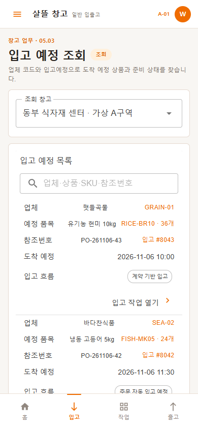</a>

창고를 고른 뒤 **업체·상품·SKU·참조번호**로 예정 입고를 찾습니다. 수량과 도착 예정 시각을 확인하고 **입고 작업 열기**를 누르면 해당 입고 건의 작업 화면으로 이동합니다.

2026-11-07 · 390px 브라우저 · 가상 입고 3건. [작업 열기 버튼 검증](../Changes/2026-11-07-warehouse-inbound-action-label.md) · [입고 예정 검색 화면 검증](../Changes/2026-11-06-warehouse-inbound-readability.md) · [별도 입고 검수 화면](../Changes/2026-10-05-state-card-polish-r18.md)

#### 창고 — 입고 검수 대상 확인

<a href="../assets/changes/2026-11-07-warehouse-inspection-list-guide/list-390.png">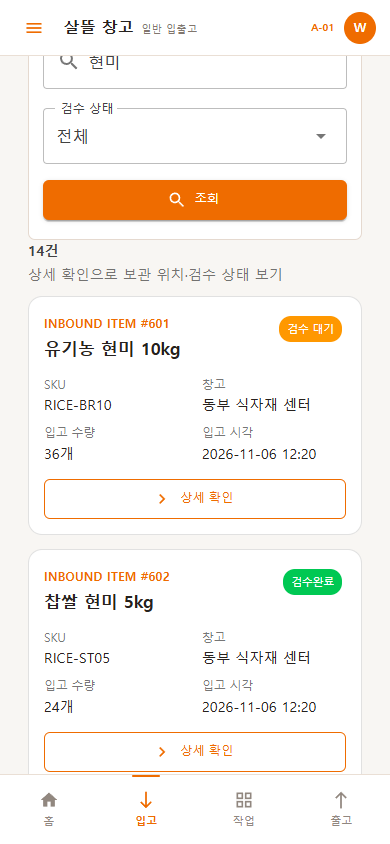</a>

입고 검수 목록에서 **상세 확인**을 누르면 선택한 상품의 보관 위치와 검수 상태를 볼 수 있습니다. 상세의 **검수 목록** 또는 **목록**으로 돌아오면 마지막 조회 조건과 페이지가 열립니다. 2026-11-07 · 390px 로컬 브라우저 · 가상 입고. [목록 안내와 복귀 검증](../Changes/2026-11-07-warehouse-inspection-list-guide.md) · [입고 시각과 검수 실행 버튼이 보이는 상세](../assets/changes/2026-11-07-warehouse-inspection-timestamp/detail-390.png) · [상세 화면 검증](../Changes/2026-11-07-warehouse-inspection-timestamp.md)

### 창고 — 출고 운송과 기사 인계 상태 확인

**인계 상태 새로고침**으로 같은 출고 건의 기사·차량 상태를 다시 확인합니다. **출고 내역 확인**을 누르면 해당 건의 **출고예정 검토** 화면이 열립니다. [2026-11-07 가상 출고 건의 390px 화면과 검증](../Changes/2026-11-07-warehouse-handoff-actions.md)

#### 창고 — 업무 단계별 처리 묶음

<a href="../assets/changes/2026-11-07-warehouse-batch-page-empty/list-390-full.png">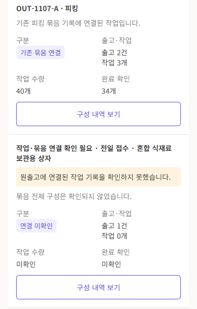</a>

선택한 창고·구간·공정의 수량을 읽고 **구성 내역 보기** → **같은 출고 검토**로 구성과 원출고를 대조한 뒤 같은 묶음과 목록으로 돌아옵니다. 현재 페이지만 비었다면 **첫 묶음 페이지로**로 같은 조건의 첫 목록을 다시 확인합니다.

2026-11-07 · 창고 전용 웹 390px 실제 Chrome/WASM · 격리 가상 업무 · 정상 표의 본문 구간과 클릭 시 전체 원본. [같은 묶음의 최신 구성 상세](../assets/changes/2026-11-07-warehouse-member-page-empty/group-390-full.png) · [통합 웹의 수정 전후 비교](../../artifacts/local/warehouse-current-batch-page-empty-20261107/comparison/comparison.html) · [이번 웹 조작·판본 검증](../Changes/2026-11-07-warehouse-batch-page-empty.md) · [이전 화면과 로그인 복귀 기록](../Changes/2026-11-07-warehouse-login-return.md)

<a href="../assets/changes/2026-11-08-warehouse-member-time-boundary/normal-stage-390.png">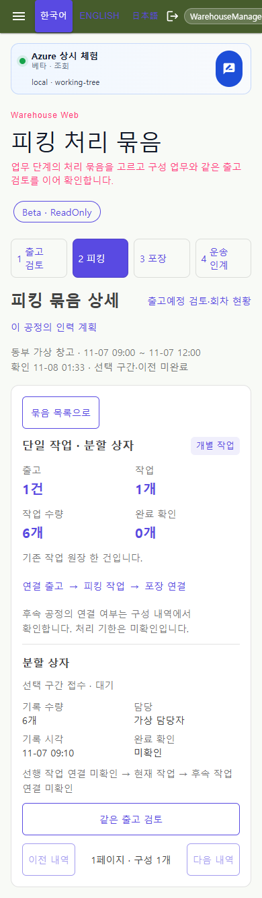</a>

통합 웹의 구성 상세에서는 가상 작업의 기록수량 **6개**, 담당·기록 시각·완료 여부를 읽고 **같은 출고 검토**로 원출고 전체수량 **10개**를 확인한 뒤 **묶음 구성 내역으로** 돌아옵니다. 정상 시각은 그대로 읽고, 표현할 수 없는 시각 때문에 화면 전체가 멈추던 사례는 **미확인**으로 구분합니다. 2026-11-08 · 통합 웹 390px 실제 Chrome/WASM · 격리 가상 업무·1280px 함께 확인. [수정 전후·원본](../../artifacts/local/warehouse-member-time-boundary-resume-20261108-1105/comparison.html) · [현재 웹·휴대폰 검증](../Changes/2026-11-08-warehouse-member-time-boundary.md) · [이전 구성 화면과 부분 페이지 복구](../Changes/2026-11-07-warehouse-member-page-empty.md).

<a href="../assets/changes/2026-11-08-warehouse-member-time-boundary/normal-native140.png">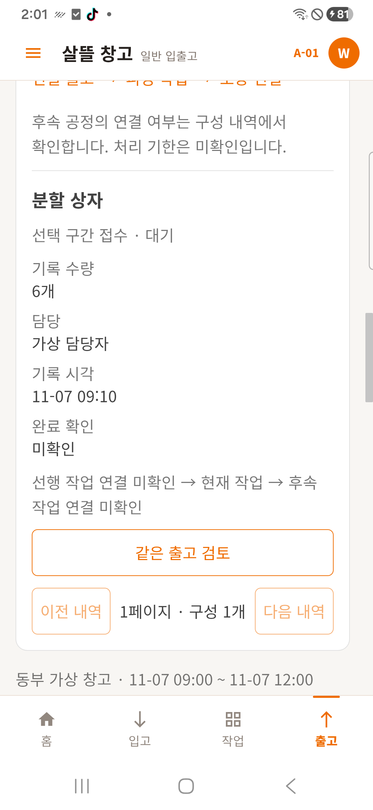</a>

창고 앱의 같은 가상 작업에서도 구성 **6개**를 읽고 **같은 출고 검토**로 전체 **10개**를 확인한 뒤 상단 **회차별 현황**으로 돌아옵니다. 2026-11-08 · 등록 USB 휴대폰의 별도 창고 검토앱140 · 실제1080×2340 원본 · 가상 계정/격리 자료. [휴대폰 수정 전후·개별 원본](../../artifacts/local/warehouse-member-time-boundary-usb-login-20261108-1330/comparison.html) · [판본·검증 범위](../Changes/2026-11-08-warehouse-member-time-boundary.md).

#### 창고·등록 인력 — 처리 묶음의 근무 가능 확인

<a href="../assets/changes/2026-11-08-workforce-availability/manager-confirmed-390.png">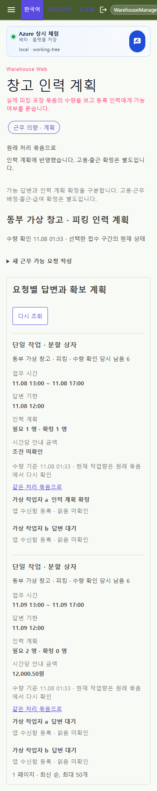</a>

피킹·포장 묶음에서 **이 공정의 인력 계획**을 눌러 남은 수량과 가정한 처리량·순작업시간을 확인하고 **가능 여부 요청 등록**으로 등록 인력에게 의향을 묻습니다. [본인 수신함](../assets/changes/2026-11-08-workforce-availability/worker-inbox-390.png)에서 **가능 / 불가 / 내 답변 철회**를 선택하고, 관리자는 **인력 계획에 확정**으로 확인한 뒤 **같은 처리 묶음으로** 돌아갑니다. 고용·출근·급여 확정은 별도입니다.

2026-11-08 · 통합 웹 390px 실제 Chrome/WASM · 격리 가상 요청 2건·등록 인력 2명 · 320·1280px 함께 확인. [기존 진입의 수정 전후와 신규 화면](../../artifacts/local/workforce-availability-20261108/comparison.html) · [판본·검증 범위](../Changes/2026-11-08-workforce-availability.md). 실제 운영 로그인·DB 적용·문자/카카오 수신·USB 확인과 구분합니다.

### 운영자 — 음식 주문 찾아 상세 확인

<a href="../assets/changes/2026-11-06-admin-food-order-touch/orders-390.png">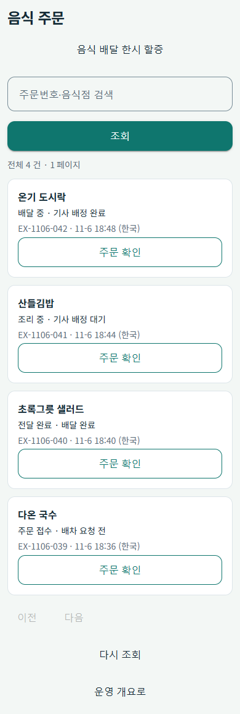</a>

음식점명이나 주문번호로 검색한 뒤 **주문 확인**을 누르면 현재 단계와 다음 담당이 표시됩니다. **음식 주문 목록으로**를 누르면 목록으로 돌아옵니다. 390px 브라우저 · 가상 주문 4건 · 목록 2026-11-06, 상세 2026-11-07. [전달 중 상태와 다음 담당이 보이는 상세](../assets/changes/2026-11-07-admin-food-order-detail-status/detail-390.png) · [상세 화면 검증](../Changes/2026-11-07-admin-food-order-detail-status.md) · [주문 목록 검증](../Changes/2026-11-06-admin-food-order-touch.md)

### 운영자 — 국내화물 배차 검토

<a href="../assets/changes/2026-11-08-admin-login-return/bundle-members-390.jpg">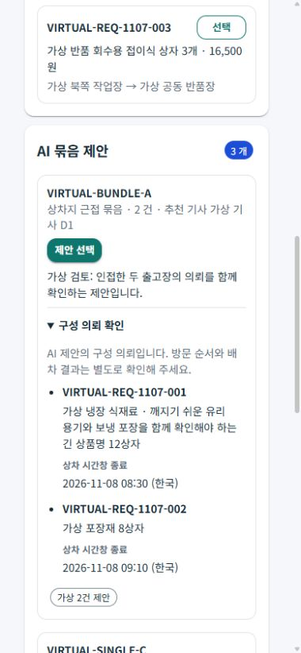</a>

로그인이 필요하면 **로그인**을 거쳐 같은 AI 배차 검토로 돌아옵니다. **구성 의뢰 확인**에서 같은 의뢰의 12상자·8상자와 상차 시간창 종료를 읽고, **제안 선택**으로 지도·현재 기사를 대조합니다.

2026-11-08 · 실제 Admin InteractiveServer · 앱 내 브라우저390px · 가상 의뢰3건·제안3개, 320/1280px 함께 확인. [로그인 복귀 수정 전후9쌍·원본](../../artifacts/local/admin-login-return-20261108-1520/comparison.html) · [검증·이전 화면·한계](../Changes/2026-11-08-admin-login-return.md).

### 운영자 — 사건 처리 이력 확인

**처리 이력**과 **안내 증빙 기록**에서 처리 시각과 시각 미확인을 구분합니다. **요청 목록으로**를 누르면 사건 목록이 열립니다. [2026-11-07 가상 사건의 390px 화면과 검증](../Changes/2026-11-07-support-history-time-wrap.md)

### 통합 업무 — 연결된 절차와 막힌 지점 확인

<a href="../assets/changes/2026-10-24-workflow-readiness-r119/mobile-blocked-nodes.png">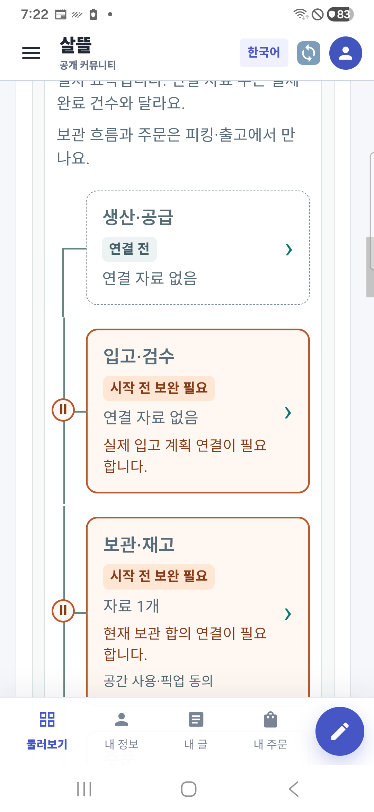</a>

2026-10-24 · 실제 휴대폰 검토 APK 화면 · [업무 시작 조건·정산 연결의 검증](../Changes/2026-10-24-workflow-readiness-settlement-r119.md)

- **보는 정보:** 생산·공급, 입고·검수, 보관·재고 등의 업무 노드와 연결선, 연결 자료 및 시작 전 보완 사유.
- **행동과 연결:** 노드를 선택해 같은 원장·회차의 상세로 들어가 필요한 정보를 확인합니다. 주문과 보관 흐름이 피킹·출고에서 만나는 구조는 [연결선 화면](../Changes/2026-10-24-mobile-work-connectors-r118.md)에서 함께 봅니다.
- **검토 질문:** 어디에서 일이 막혔고 무엇을 보완해야 하는지 알 수 있는가? 연결선과 실제 업무 완료를 구분할 수 있는가?

더 많은 화면은 [화면별 상세 README](../ProjectOverview/page-docs/README.md)와 [전체 페이지 카탈로그](../ProjectOverview/app-page-catalog.md)에서 찾습니다. 음식점 주문 화면과 운영자 화면도 이 목차에서 연결됩니다.

[저장소 첫 화면으로](../../README.md)
