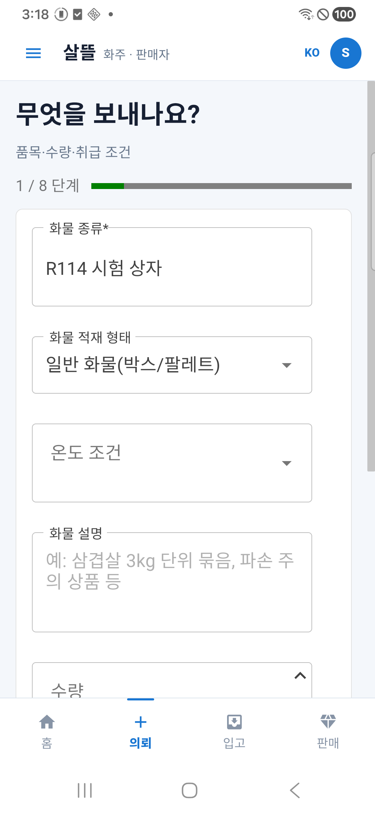
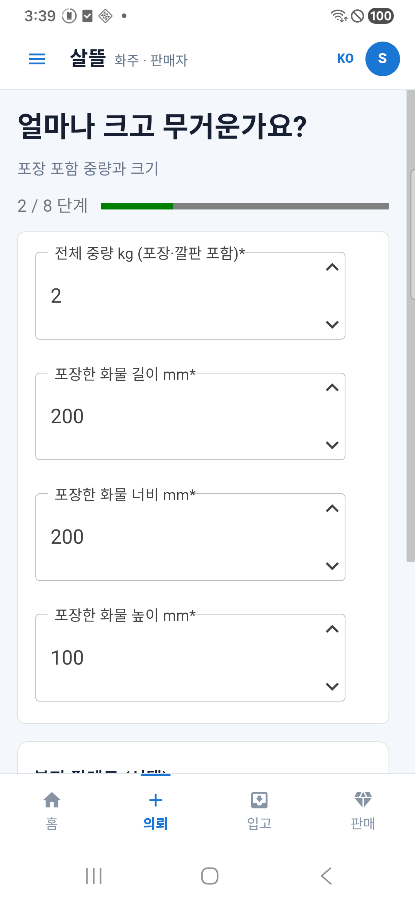
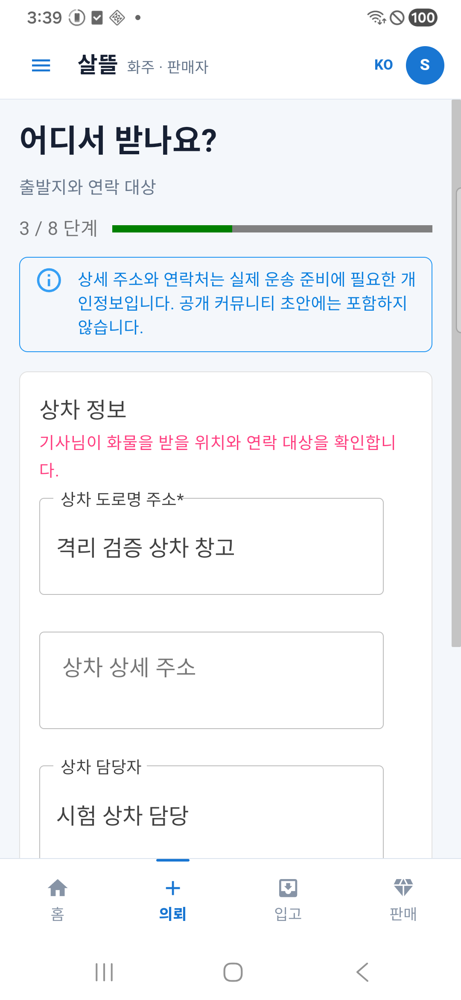
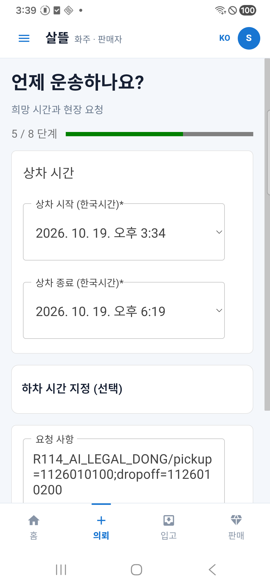

# 실제 휴대폰의 화주 맥락별 입력

APK 0.1.200을 설치한 Android 휴대폰에서 촬영한 화면이다. 입력값은 가상 자료이며 지도·카메라 원본·실제 연락처를 포함하지 않는다. 첫 화면은 최초 8단계 검사, 나머지는 부피까지 입력한 후속 의뢰 검사다. 같은 단일 주문의 모든 단계라고 합치지 않는다.

[검증 결과](../../../Changes/2026-10-19-mobile-context-authoring-r72.md) · [파일 해시](manifest.json)

## 물품 입력

## 포장·중량 입력

## 출발지 입력

## 시간 입력

