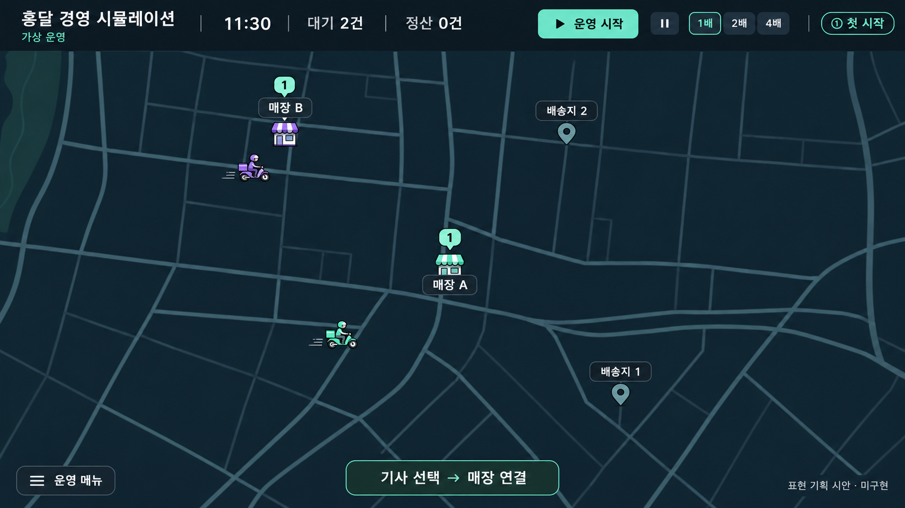
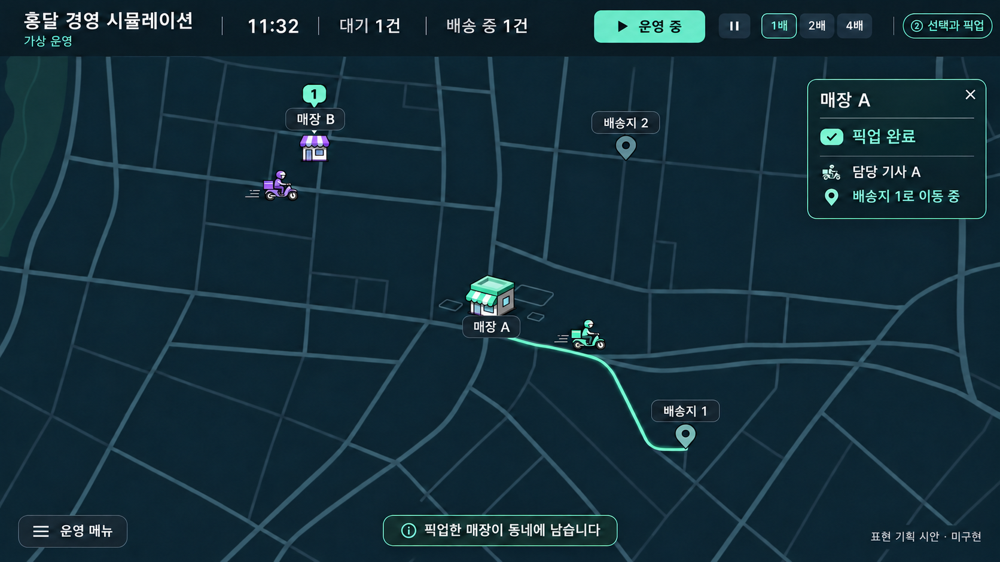
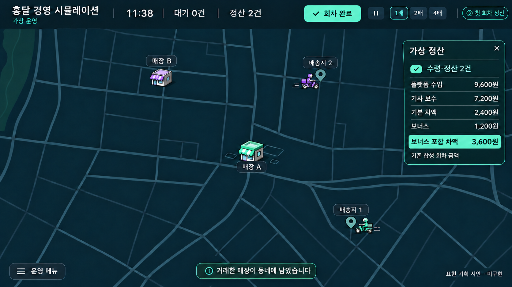
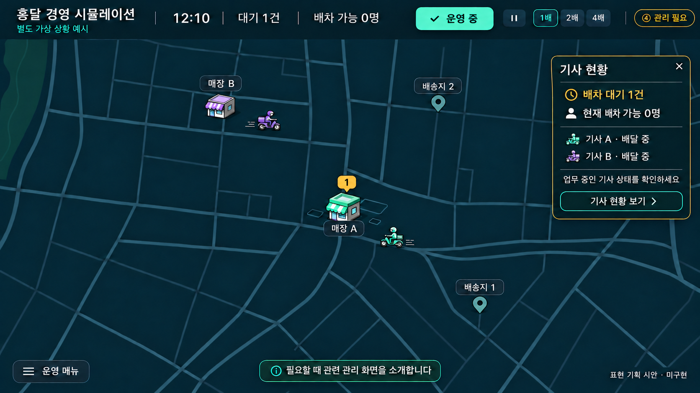

# 홍달 경영 시뮬레이션 — 플레이에 따른 화면 변화

2026-11-12 · **표현 기획 시안, 제품 미구현, 사용자 검토 대기**

[기획 r141](../../../AI/Planning/시스템/PLAN-SYSTEM-REGIONAL-OPERATOR-SIMULATION/progressive-focus-ui-and-place-reveal.r141.md) · [실제 사용 프롬프트](generation-prompts.md)

기존 r137 Windows 화면의 남색·민트·지도 중심 구성을 참고해 생성한 이미지다. 실제 실행 화면·구매 에셋의 Unity 렌더·실제 동네의 정밀 복원은 아니다. 지도·객체 배치는 시안용 합성 표현이며 실제 게임의 배차나 정산 규칙을 바꾸지 않았다.

## ① 첫 시작

기사 두 명·주문 두 건. 도로·핀·오토바이와 연결 안내에 집중하고 관리 화면은 메뉴에 접어둔다.

## ② 선택과 픽업

기사 A의 픽업을 확인한 매장 A만 낮게 입체화한다. 진행 중인 전달 경로와 상세 하나를 표시하고 B 주문은 대기로 유지한다.

## ③ 첫 회차 정산

두 주문을 마치면 A/B 매장은 거래 흔적으로 남는다. 수입·기사 보수·기본 차액·보너스와 총차액을 나눈다. 표시 금액은 기존 합성 두 주문의 검증 기록이며 실제 수입이 아니다.

## ④ 관리 필요

**별도의 가상 상황 예시다.** 두 기사 모두 업무 중이고 미지정 주문 한 건이 기다릴 때 관련 기사 현황을 소개한다. 앞 장면 뒤 자동 발생한 결과나 새 모집 기능 구현을 뜻하지 않는다.

후속 구현은 [소비판별 구현 현황](../../../AI/Handoffs/Unity-Windows-구현현황.md)을 먼저 대조한다. 단계별 소개·선택 보존·거래 흔적 저장은 아직 구현하지 않았다. 원본 캡처와 시안의 참조/출력 지문·국소 보정·문서 검증은 [제작 기록](../../../../artifacts/local/hongdal-progressive-ui-r141-20261112/completion.json)에 보존한다.
