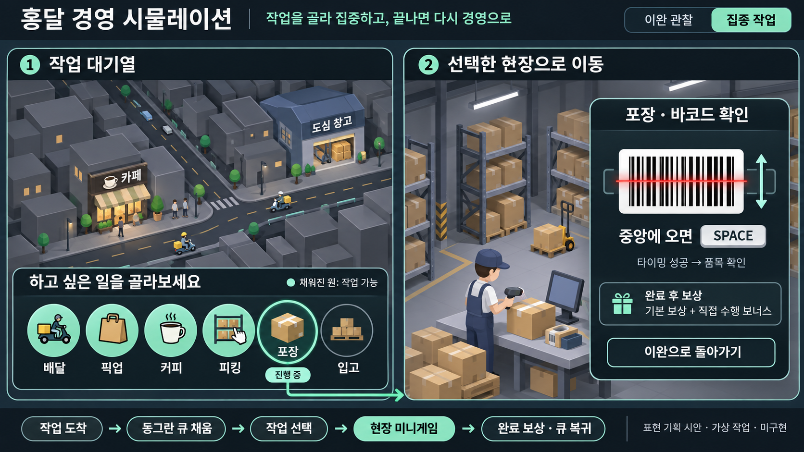

# 작업 대기열 → 현장 미니게임 시안 r149

2026-11-12 사용자 요청으로 만든 **생성 이미지 시안**이다. 내장 이미지 생성 도구를 사용했으며 Unity 실행 화면·실제 입력 검증·구매 모델 배치 결과가 아니다. 배치·색·전환 흐름을 검토하기 위한 가상 동네와 작업이다.

- [기획 정본 r149](../../../AI/Planning/시스템/PLAN-SYSTEM-REGIONAL-OPERATOR-SIMULATION/task-queue-role-minigame.concept.r149.md)
- [실제 생성 프롬프트](generation-prompt.txt)
- 표현 참조: [Claude 동네·사업층 시안](../../../../artifacts/local/hongdal-unity-claude-20261112/mockups/통합구조-20261112/01-동네-사업층.png). 회색 동네·남색 패널·민트 강조를 이어가며 대기열·포장 현장으로 재구성했다.
- 왼쪽과 오른쪽은 전환 전/후 두 상태다. 원 여섯 개는 역할별 작업 모양 예시이고 실제 작업 수·수행 순서의 확정값이 아니다. 선택한 포장은 `진행 중`, 보상은 `완료 후`로 표시한다.
- 확인: 한국어 제목·여섯 역할·선택 테두리·창고 선반/포장대·가로 빨간 선과 상하 화살표·Space·품목 확인·이완 복귀·미구현 표기를 이미지에서 확인했다. 시각 채택은 사용자 검토 대기다.

보존 정보:

| 대상 | 값 |
| --- | --- |
| 결과 | `01-task-queue-to-minigame.png`, 1672×941 PNG |
| 결과 SHA-256 | `07e82eba7927215da2913849666f45114e8ec65c129e93602c817a399c2ff452` |
| 참조 SHA-256 | `36d8263ac6952a7f0bb8d9b6e7623ef65cc05df126ed87c3b2db609f2d24d71b` |
| 원본 생성 경로 | `C:/Users/user/.codex/generated_images/01a1cdeb-1060-74a0-8cb8-5da194b19603/exec-15dc29ea-6608-4f2e-bbb1-6c0202af94fe.png` |

생성 원본은 보존하고 이 폴더로 복사했다. 프롬프트의 장면·역할·수치 제한은 이 시안에만 적용되며 기존 Core 통합·우유 5팩 구현 계약을 변경하지 않는다.
